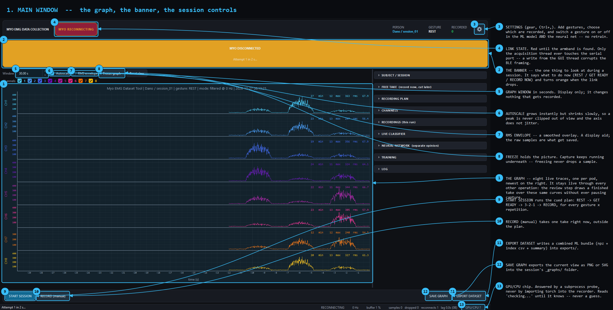

<p align="center"></p>

# emg

Labeled 8-channel EMG gesture recording tool for the Thalmic Myo armband, plus
the training and validation pipeline that goes with it.

**The deliverable is the recording tool, not a model.** The point is a clean,
honestly-labelled dataset with subject-independent validation — because on
this problem the dataset is the bottleneck and the classifier is not.



---

## Features

Full list, with how to turn each on and off: [`docs/FEATURES.md`](docs/FEATURES.md).

- Live 8-channel plot, labelled capture, quality checks, trimming, annotation
- Two live models: ML soft vote (the answer) and a neural net (second opinion)
- Per-wearer calibration; background training; TEST MODEL
- Settings (gear, `Ctrl+,`) with per-gesture RECORD / USE IN CLASSIFIER switches
- A **model zoo** (16 ML classifiers, 9 neural nets): every model trained and
  scored with a person held out, listed with its size, the best marked with a
  star, any of them selectable in the settings, several voted (soft vote) -- off
  by default, the original models stay the default
- Augmentation and adaptation to the person (per family), switched on only
  where the ablation study measured a gain ([`docs/REPORT.md`](docs/REPORT.md))
- **Train without some people** (Settings -> Training), with ready-trained
  `... (without <name>)` models, blue stars for the ones that score higher than their
  yellow-star model on the same people, and the measured with/without comparison of every
  training switch ([`docs/EXCLUDING_PEOPLE.md`](docs/EXCLUDING_PEOPLE.md))
- Two questions the application asks: calibrate the hand before PREDICT /
  START NN (reuse the last calibration only after a restart), and retrain all /
  only the selected models when something is out of date
- App icon; `docs/sdk_myo.md` for a new band; install guides for Windows and Linux

## Quick start

- Windows: [`docs/install_windows.md`](docs/install_windows.md)
- Linux: [`docs/install_linux.md`](docs/install_linux.md)
- Myo SDK / protocol notes: [`docs/sdk_myo.md`](docs/sdk_myo.md)

Short version: `python -m pip install -r requirements.txt`, then
`python emg_dataset_tool.py`.

Results and report: [`docs/REPORT.md`](docs/REPORT.md) (numbers in
`results/experiments.json`); verification: [`docs/VERIFICATION.md`](docs/VERIFICATION.md);
decisions: [`docs/NOTES.md`](docs/NOTES.md).

---

## Contents

- [Features](#features)
- [Quick start](#quick-start)
- [Install and run](#install-and-run)
- [What it does](#what-it-does)
- [Recording workflows](#recording-workflows)
- [From recordings to a model](#from-recordings-to-a-model)
- [The two models: ML vote and neural net](#the-two-models-ml-vote-and-neural-net)
- [Using it day to day](#using-it-day-to-day)
- [The honesty machinery](#the-honesty-machinery)
- [Safety rules](#safety-rules)
- [Where things live](#where-things-live)
- [Documentation](#documentation)
- [Tests](#tests)
- [Current state](#current-state)

---

## Install and run

```powershell
python -m pip install -r requirements.txt     # once

python emg_dataset_tool.py                    # the application
python emg_dataset_tool.py --summary          # dataset stats, no GUI

python training/train_model.py --spec models\model_spec.json    # the ML trainer (CPU)
python training/train_nn.py                                    # the neural net (CUDA)
python training/explain_votes.py                               # rebuild the DECISION TRAIL file
python training/nn_ml_comb_test.py --watch                     # the ML+NN search, progress view
python tools/bench_models.py                                   # time both models per live window
```

All of these can also be started from the app; the trainers then run as a
background job that survives closing the window.

Required: `pyserial`, `numpy`, `PySide6`, `pyqtgraph`.
Optional: `scikit-learn` + `joblib` (training and the live classifier),
`pandas`, `scipy`, `pyarrow`.

Needs a Myo armband and a Bluegiga BLED112 dongle. Windows, in practice — the
COM-port handling has not been tried elsewhere. Only one process can hold the
port, so close `legacy/test_myo.py` before starting the tool.

**The recorder never imports torch.** It asks a subprocess whether a GPU exists, and runs the neural net in another one, so the app starts, records and predicts identically with torch absent.

---

## What it does

```
BLED112 dongle on COM3
        │  pyserial
   myo_raw.BT                      BLE/BGAPI packet framing
        │
   myo_raw.MyoRaw                  Myo protocol, set_mode, notifications
        │  add_emg_handler(fn)
   MyoAcquisition                  background thread, ring buffer, capture
        │  Qt signals (state only) + ring buffer reads
   MainWindow                      the GUI
```

Eight dry EMG pods at ~50 Hz (`filtered` mode, rectified on-device) or 200 Hz
(`raw` mode). Live plot, labelled capture, quality checks, trimming,
annotation, export, and two models on the live stream:

- **the LIVE CLASSIFIER** — a scikit-learn soft vote, the app's answer;
- **the NEURAL NETWORK** — a small GRU on the GPU, a separate second
  opinion that is never averaged in.

Around them: **per-wearer calibration** (required once per wearer),
**background training** that keeps going when the window is closed,
**RETRAIN ML + NEURAL NET** in one button, and **TEST MODEL**, which scores
the model on you, live. Every screen is explained, with annotated
screenshots, in [`docs/UI_GUIDE.md`](docs/UI_GUIDE.md).

**Everything in `emg_app/` outside `gui/` is Qt-free** and importable headless,
which is what lets a training script do `import emg_dataset_tool as T;
T.load_dataset(...)` on a machine with no display.

---

## Recording workflows

Three independent paths. **The free-take route is the one in use.**

### Free take — record now, cut later

```
START FREE TAKE (Ctrl+Shift+R)   one continuous capture, minutes long
STOP & SAVE TAKE                 the whole stretch -> <session>/_takes/
OPEN TAKE(S) & CUT CLIPS         carve labelled clips out of it, any time
    EXTRACT CLIP (Ctrl+Space)      -> an ordinary stage-raw recording
    NEXT >> (Ctrl+Right)           -> step one clip length along
```

### Cued sequence

`START SESSION` walks `GESTURES × REPETITIONS`:
`REST → PREPARE → 3-2-1 → RECORD → review`. The capture window is wider than
the labelled window, so an early reaction or an overshooting contraction is
still in the raw file.

### Label on graph

Select a span on the live plot and save it. No countdown, no plan.

### Markers, any time

`Ctrl+M` note · `Ctrl+B` break · `Ctrl+Shift+Space` cut since last marker.
Timestamped off the newest **sample**, not the GUI clock.

> **How to actually record**, in one line: make the gesture, let it settle,
> then **hold it relaxed at the effort you would really use**, and take the
> armband off between sittings. The full protocol is in
> [`docs/UI_GUIDE.md`](docs/UI_GUIDE.md#the-five-minute-version).

---

## From recordings to a model

```python
import emg_dataset_tool as T

recs = T.load_dataset("datasets", stage="prefer_trimmed")
X, y, groups, meta = T.make_windows(recs)      # (n, win, 8), labels, person ids
feats, names = T.make_feature_matrix(X, meta["fs"])

for train, test, held_out in T.leave_one_person_out(groups):
    ...
```

`groups` is the whole point.

In practice just press **RETRAIN ON ALL DATA** (or **RETRAIN ML + NEURAL
NET**). The setup and the vote members were chosen by a 10.5-hour search
(`training/nn_ml_comb_test.py`, results in
[`docs/COMB_TEST.md`](docs/COMB_TEST.md)) and are **pinned** in
`models/model_spec.json`, so a retrain takes ~1.5 minutes instead of
re-sweeping. Unpin it in MODEL SPEC and the trainer runs its full
**three-stage sweep** again — cheap screen, shortlist probe, full evaluation;
see [`docs/how_to_fix_long_training.md`](docs/how_to_fix_long_training.md).

**Training is calibrated, always the same way.** Every wearer's training data
is calibrated from their own recordings (labels unused), so everyone is on
one scale. Your live calibration is what PREDICTING uses.

Four representations: `raw`, `normalized`, `envelope`, `bandpass` (a hand-
written zero-phase Butterworth that deliberately does not import scipy).
Which one wins is measured, never asserted.

One feature function, `model_feature_vector()`, is shared by the trainer and
the live predictor. If those drifted apart by one feature, live predictions
would be garbage while the cross-validation score stayed perfect.

---

## The two models: ML vote and neural net

Both scored the same way: every fold holds out **one whole person**, trained
on the other four. Full comparison, with every number's source:
[`docs/MODELS_COMPARED.md`](docs/MODELS_COMPARED.md).

| | ML: soft vote ExtraTrees + RandomForest | NN: GRU 0.7 s |
|---|---|---|
| accuracy per window, new person | **77.6 %** (74.0 % nested) | 72.4 % |
| accuracy per gesture | **83.7 %** | 78.9 % |
| same person, held-out recordings | 97.4 % | 95.3 % |
| time per live window | ~52 ms (CPU) | **1.8 ms** (GPU) |
| size | ~17.7 MB | **25 KB** |
| needs | scikit-learn | torch (in a subprocess) |

- **The ML vote is the more accurate on a stranger. The net is about 300×
  smaller and 30× faster**, and reads the timing of the signal that the ML
  model ignores.
- Both struggle with the same thing: telling **FIST, OPEN and THUMB_UP**
  apart, and **one wearer (Barbora)** whose band pattern differs.
- **Keep the vote to the two forests.** Adding SVM and LDA to it costs about
  8 points (measured: 69.5 % per window).

---

## Using it day to day

The full walkthrough with pictures is the
[five-minute version](docs/UI_GUIDE.md#the-five-minute-version). In short:

1. **Calibrate** the wearer (CALIBRATE → START SWEEP → SAVE).
2. **Record** (free take, then cut clips).
3. **Train** — RETRAIN ML + NEURAL NET. You can close the app meanwhile.
4. **Restart** the app, put the band on and **calibrate again**.
5. **Predict** — PREDICT for the ML answer, START NN for the second opinion.
   **TEST MODEL** tells you how well it works on you.

**A new gesture** is added in **GESTURES…** → ADD YOUR OWN (a name and how
to do it). It appears everywhere at once — dropdowns, plan, calibration, cues,
its own colour — and is saved with the data. **Nothing retrains by itself:**
the panel tells you the models don't know it yet, and you press RETRAIN when
you have recorded it on at least two people
([guide](docs/UI_GUIDE.md#10-adding-a-new-gesture)).

---

## The honesty machinery

This is the part worth reading. The project assumes any good-looking number is
wrong until proven otherwise, and the tooling enforces that rather than
relying on memory.

**The DC-only control runs on every training run.** It re-scores the winner
using *only* the 8 per-channel mean levels — no shape, no spectrum, no timing
— and prints how much the other features added. If 8 numbers score as well as
50, nothing has been learned about gestures. Under 5 points of gain the run
prints a warning naming the confound, and both numbers go into the sweep
report and the saved payload.

**Both validation protocols are always reported.** With one subject, folds are
grouped by recording; with two or more they switch to subject-grouped
automatically, because otherwise the sweep *selects* a setup that leans on one
person's amplitudes. The winner block prints the chosen protocol and the other
one as contrast, and warns when they disagree by more than 5 points.

**Window-level deduplication is correctness, not speed.** Clips cut from a
take tile it with ~50 % overlap, and grouping CV by recording uid does not
separate them because every clip legitimately owns its uid. Without dedup the
same samples sit in train and test.

**Selecting a model never flatters it.** The model spec decides what gets
trained, never how it is scored. Where selection bias exists (AUTO mode), it
is stated in the dialog, the log and MODEL STATS rather than hidden.

**The feature space view is a PCA, not an LDA** — an LDA would separate the
labels by construction and look clean even when the separation is electrode
drift.

**The GPU badge never guesses.** Until the subprocess probe answers it reads
`checking…`, and because the sklearn sweep has no GPU backend, both the
tooltip and the RETRAIN dialog say in words that RETRAIN runs on the CPU even
when the badge is green.

---

## Safety rules

Invariants. Breaking one is a bug, not a trade-off.

1. **Raw is written once and never rewritten.** `*_raw.*` are immutable.
2. **Nothing is overwritten.** Every write goes through `unique_path()`.
3. **Trimming creates new files** with a new stage suffix.
4. **Deleting quarantines into `_deleted/`** — never `os.remove`.
5. **Bad recordings are flagged, never discarded.** The operator decides.
6. **Samples are captured on the acquisition thread**, so a slow frame cannot
   drop one.
7. **Every file gets a config snapshot.**
8. **Annotating never edits data.** Notes go to a sidecar; the marker log is
   append-only.
9. **A free take is never training data**, and cutting from it never alters
   it.
10. **No fake predictions.** Only a real model's `predict()`.
11. **Selecting a model never flatters it.**
12. **Calibration never rewrites signal**, and a bad one is refused.
13. **The neural net never contributes to the app's answer.**

---

## Where things live

```
emg_dataset_tool.py   the entry point: python emg_dataset_tool.py
emg_app/              the application package (module map: emg_app/README.md)
training/             trainers, job runner, NN worker, the comb test
tools/                report and screenshot generators
tests/                runnable check scripts
docs/                 every other document
legacy/               retired code, kept for the record
datasets/ models/ exports/
```

| Path | Role |
|---|---|
| `emg_dataset_tool.py` | the entry point, and `import emg_dataset_tool as T` still exposes every name in the package |
| `emg_app/` | the application, split by topic: config, signal processing, calibration, features, dataset, acquisition, neural engine, jobs, prediction, and `gui/` (widgets, one file per dialog, the main window as one mixin per feature) |
| `emg_app/myo/myo_raw.py` | the Myo BLE protocol wrapper — **the working communication layer** |
| `training/train_model.py` | the three-stage sweep, honest validation, saves `models/gesture_model.joblib` |
| `training/explain_votes.py` | rebuilds the DECISION TRAIL side file without re-running a sweep |
| **`training/train_nn.py`** | trains the **neural network** -- a separate second opinion, on CUDA, never part of the answer |
| `training/nn_arch.py` / `nn_serve.py` | its architectures, and the subprocess that serves it live |
| `training/train_job.py` | runs training in the background, so closing the app does not stop it |
| `training/nn_ml_comb_test.py` | the ML + NN combination search ([`docs/COMB_TEST.md`](docs/COMB_TEST.md)) |
| `tools/make_ui_guide.py` | regenerates the annotated screenshots in `docs/images/` |
| `tools/bench_models.py` | times both models per live window, on real recordings |
| `legacy/` | the **retired** `train_torch.py`, the original `myo.py` demo and `test_myo.py` monitor |
| `datasets/` | recorded data (`_`-prefixed folders are never discovered) |
| `models/` | the models, specs, the panel, timestamped archives, `reports/`, `comb_test/` |
| `exports/` | combined ML bundles |

---

## Documentation

| File | What it covers |
|---|---|
| [`docs/FEATURES.md`](docs/FEATURES.md) | every feature: what, on/off, default and why, code location |
| [`docs/REPORT.md`](docs/REPORT.md) | report of the latest work: models, ablation, robustness, latency |
| [`docs/install_windows.md`](docs/install_windows.md), [`docs/install_linux.md`](docs/install_linux.md) | installation per platform |
| [`docs/sdk_myo.md`](docs/sdk_myo.md) | Myo SDK and protocol notes |
| [`docs/NOTES.md`](docs/NOTES.md) | decisions and open questions |
| [`docs/VERIFICATION.md`](docs/VERIFICATION.md) | independent check of the claims |
| [`docs/calib_plan.md`](docs/calib_plan.md), [`docs/recommendation.md`](docs/recommendation.md) | calibration design study; earlier recommendations |
| [`docs/MANUAL.md`](docs/MANUAL.md) | **the complete manual** — install, architecture, the interface, the ML pipeline, and the full engineering record of what broke and how it was fixed |
| [`docs/UI_GUIDE.md`](docs/UI_GUIDE.md) | **the UI, screen by screen, with annotated screenshots** |
| [`docs/GUIDE.md`](docs/GUIDE.md) | user manual: every file, every setting, ready-made presets |
| [`CLAUDE.md`](CLAUDE.md) | orientation and the invariants — read before changing anything |
| [`emg_app/README.md`](emg_app/README.md) | the package's module map and the two rules that keep the split correct |
| [`docs/MODELS_COMPARED.md`](docs/MODELS_COMPARED.md) | **ML models, soft voting and the neural net compared** — accuracy, speed, size, training time, which to use |
| [`docs/COMB_TEST.md`](docs/COMB_TEST.md) | the ML + NN combination test of 2026-10-22, every number |
| [`docs/EDA.md`](docs/EDA.md) | **what is actually in `datasets/`, measured** — read before quoting any accuracy |
| [`docs/how_to_fix_long_training.md`](docs/how_to_fix_long_training.md) | why the sweep took 3 h 16 m and what was done |
| [`docs/DATASET.md`](docs/DATASET.md) | on-disk format, filenames, CSV/NPZ schema |
| [`docs/ARCHITECTURE.md`](docs/ARCHITECTURE.md) | threads, buffers, state machine, data flow |
| [`docs/ML_PIPELINE.md`](docs/ML_PIPELINE.md) | recordings to a validated model |
| [`docs/problems.md`](docs/problems.md) | every failure hit, the fix tried, and whether it worked |
| [`tests/README.md`](tests/README.md) | the check scripts; three need the armband |

---

## Tests

**2064 checks across eighteen scripts that need no armband — all green on
2026-10-22**, after the reorganisation into `emg_app/`:

```powershell
python tests\test_datalayer.py        # 150    python tests\test_trail.py       # 103
python tests\test_gui.py              # 109    python tests\test_sweep_cost.py  #  48
python tests\test_review.py           #  50    python tests\test_filters.py     #  52
python tests\test_label_on_graph.py   #  48    python tests\test_predict.py     # 109
python tests\test_markers.py          #  88    python tests\test_model_spec.py  # 346
python tests\test_free_take.py        # 268    python tests\test_no_torch.py    #  11
python tests\test_nn.py               # 158    python tests\test_calibration.py # 161
python tests\test_jobs.py             #  48    python tests\test_device.py      # 104
python tests\test_custom_gesture.py   # adding a gesture end to end (~5 min)
python tests\test_torch.py            # 163  (the retired trainer; needs the GPU)
```

`test_live*.py` need the armband.

---

## Current state

**Five wearers, 211 recordings** — Barbora, Betka, Bruno, Dano, Miso — six
gestures, relaxed holds. Both models are trained on all of it and are in the
app (2026-10-22):

```
                         per window (new person)   per gesture   same person
ML vote ET + RF          77.6 %  (74.0 % nested)    83.7 %        97.4 %
NN GRU 0.7 s             72.4 %                     78.9 %        95.3 %
majority class           ~18 %
```

- **Read the ± before the mean.** Held out one at a time, four people score
  70–92 %, while **Barbora scores 28–46 % with every model**. It was
  suspected to be a band sitting rotated on the arm; testing that did **not**
  support it (rotation augmentation and a one-pod shift do not explain her,
  and leaving her out of training changes the others by under a point on
  average: [`docs/EXCLUDING_PEOPLE.md`](docs/EXCLUDING_PEOPLE.md)). Not
  something tuning fixes; more wearers and a better fit of the band on her
  arm are the next steps.
- **What the ML model reads.** Its DC-only control equals its full score
  (77.8 % against 77.6 %): it reads each channel's calibrated activation
  level and nothing else. The net's timing is worth +9.2 points to it.
  Neither number is a flaw; both are the honest description.

History, kept because it is the reason the tooling looks the way it does:

- **The 325-recording dataset** (archived in
  `datasets/_archive_pre_r1_20261015/`, not deleted) scored 99.6 %. That was
  not gesture recognition: the DC-only control also scored 98.9 %, because
  every gesture was a single take.
- **The second wearer** gave the first honest, subject-grouped number:
  83.3 % on two people.
- **Five wearers and a held-out person** give the numbers above.

**Do not quote an accuracy from this project without its protocol and the
DC-only control next to it.** That rule is the whole reason the tooling prints
them.
