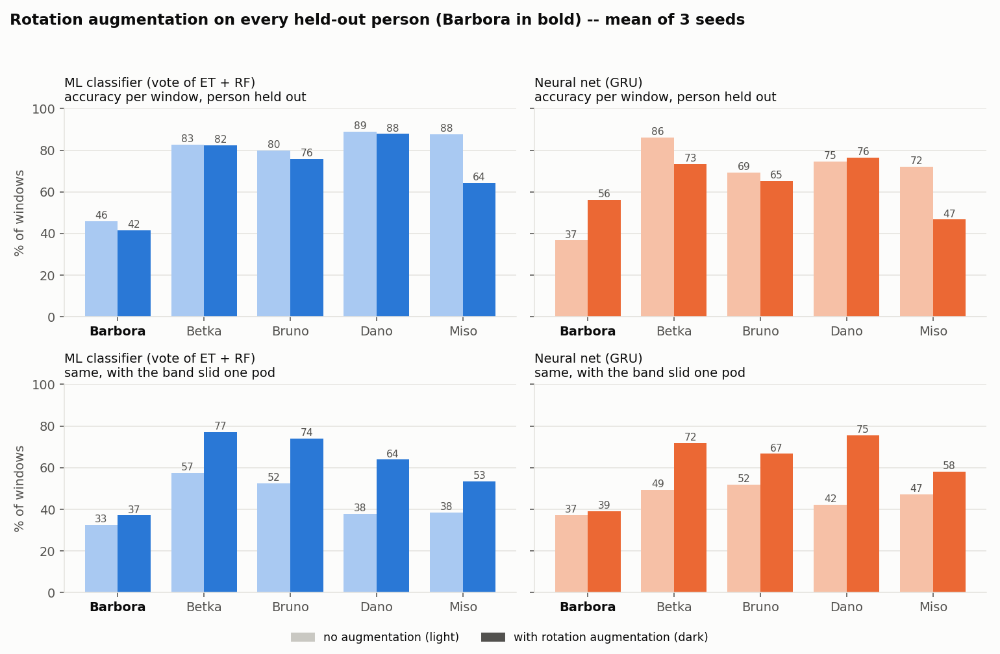
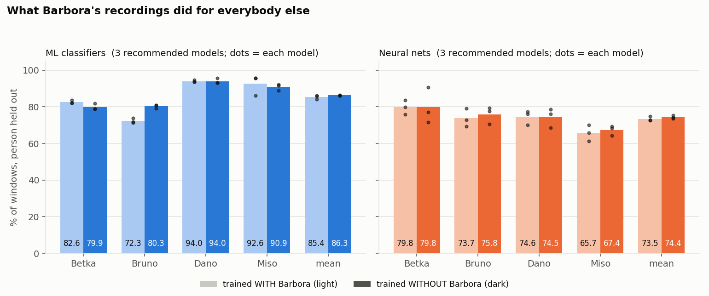
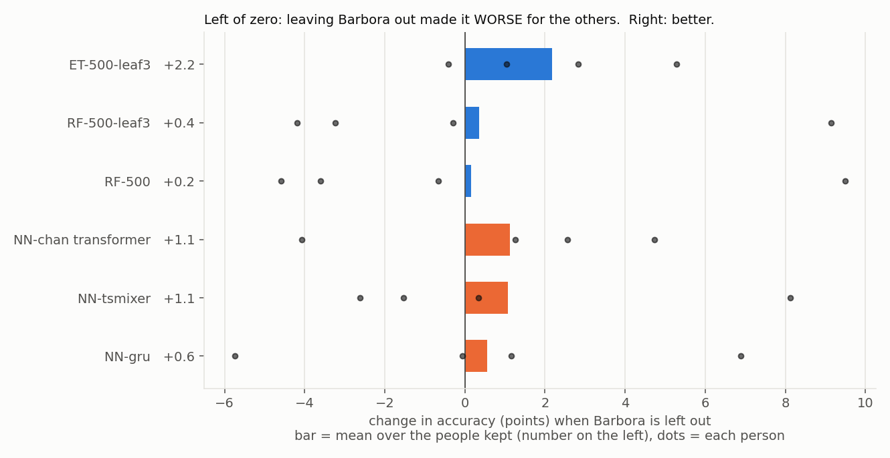
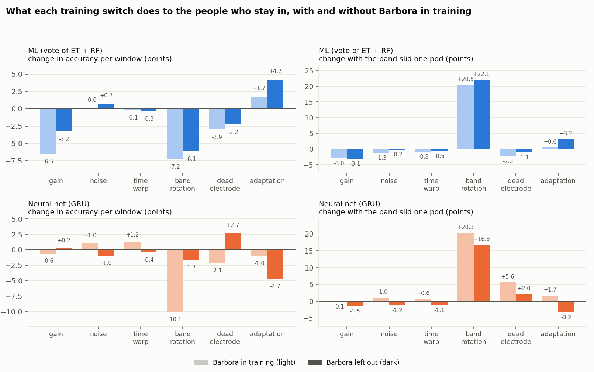

# Training without Barbora: what was tried, what it did

*Generated by `tools/make_exclusion_report.py` from the saved runs (`results/ablation/`, `models/zoo/`); every number below is read from them, none is typed by hand. The numbers are also in `results/exclusion.json`.*

## 1. The question

Barbora is the hard fold (CLAUDE.md 8, docs/MODELS_COMPARED.md): a model that never saw her reads her far worse than anybody else. Two things were tried, in this order.

1. **Rotation augmentation** (the band slid round the arm during training), checked on Barbora's fold -- the explanation offered was a band worn at a different angle.
2. If that does not help, **leave Barbora's recordings out of training**, as a setting, with the recommended models trained that way and ready.

## 2. Rotation augmentation on her fold

Leave-one-person-out, 3 seeds each, the same protocol as every other number in the project (these are the ablation study's runs, `results/ablation/*/runs.jsonl`). Accuracy per window of the held-out person.



**ML (vote of ET + RF)**

| held-out person | no augmentation | rotation | change |
|---|---|---|---|
| **Barbora** | 45.9 % | 41.6 % | -4.3 |
| Betka | 82.7 % | 82.3 % | -0.4 |
| Bruno | 79.9 % | 75.9 % | -4.0 |
| Dano | 88.9 % | 87.8 % | -1.0 |
| Miso | 87.7 % | 64.2 % | -23.5 |
| mean of 5 | 77.0 % | 70.4 % | -6.6 |

**Neural net (GRU)**

| held-out person | no augmentation | rotation | change |
|---|---|---|---|
| **Barbora** | 36.7 % | 56.1 % | +19.4 |
| Betka | 86.0 % | 73.4 % | -12.7 |
| Bruno | 69.2 % | 65.2 % | -4.0 |
| Dano | 74.7 % | 76.5 % | +1.8 |
| Miso | 72.1 % | 46.7 % | -25.4 |
| mean of 5 | 67.7 % | 63.6 % | -4.2 |

With the band slid one pod (the thing the augmentation exists for):

| | ML no aug. | ML rotation | NN no aug. | NN rotation |
|---|---|---|---|---|
| **Barbora** | 32.6 % | 37.1 % | 37.3 % | 39.2 % |
| Betka | 57.4 % | 77.0 % | 49.3 % | 71.7 % |
| Bruno | 52.4 % | 74.1 % | 51.9 % | 66.7 % |
| Dano | 38.0 % | 63.9 % | 42.3 % | 75.5 % |
| Miso | 38.4 % | 53.4 % | 47.2 % | 58.1 % |

**Verdict: it does not help in a way that can be deployed.**

- **ML:** Barbora goes 45.9 -> 41.6 % (-4.3 points): no help, and the mean over everybody is -6.6.
- **NN:** Barbora goes 36.7 -> 56.1 % (+19.4 points), but the three seeds disagree a lot (no augmentation: 48.8, 29.8, 31.6; rotation: 42.2, 61.6, 64.5), and it costs Miso -25.4 points; the mean over everybody is -4.2.
- **It does what it is for, but not for her.** With the band slid a pod, rotation raises the other people's accuracy a lot, and Barbora's only from 32.6 to 37.1 % (ML) and 37.3 to 39.2 % (NN). So a one-pod roll is **not** what makes her hard to read: the earlier suggestion that it is a rotated band is not supported by this test. What differs about her is something else, and these runs cannot say what.

- **What did help her, for ML, is adaptation to the person** (each person standardised with their own statistics, already the shipped ML default): the same ablation measured vote(ET+RF) without adaptation 45.9 %, vote(ET+RF) with adaptation 60.5 %, ET-500 without adaptation 42.3 %, ET-500 with adaptation 60.1 %, RF-500-leaf3 without adaptation 45.6 %, RF-500-leaf3 with adaptation 60.5 %. That is a bigger move than rotation made for any model, and it did not need her data excluded.

## 3. Training without Barbora

The recommended (starred) models, the three best ML classifiers and the three best nets, were trained again with exactly the same settings but without Barbora's recordings, and scored leave-one-person-out on the people left (Betka, Bruno, Dano, Miso). They are saved as `<id>-without-<name>` beside the originals (`models/zoo/`), the originals are untouched, and they are listed in Settings -> Models.

### How to read the comparison

For a kept person the two numbers are a model that **never saw them**, trained on everybody else -- with or without Barbora among the others. So the difference is exactly what Barbora's recordings did for that person; nothing else changes. Barbora herself is in neither test fold: her number is the same either way (the ordinary model's held-out fold).





### Per person, mean of the three models in each family

| family | person | with Barbora | without | change |
|---|---|---|---|---|
| ML | Betka | 82.6 % | 79.9 % | -2.7 |
| ML | Bruno | 72.3 % | 80.3 % | +8.0 |
| ML | Dano | 94.0 % | 94.0 % | +0.0 |
| ML | Miso | 92.6 % | 90.9 % | -1.7 |
| **ML** | **mean of 4** | 85.4 % | 86.3 % | **+0.9** |
| NN | Betka | 79.8 % | 79.8 % | +0.1 |
| NN | Bruno | 73.7 % | 75.8 % | +2.1 |
| NN | Dano | 74.6 % | 74.5 % | -0.1 |
| NN | Miso | 65.7 % | 67.4 % | +1.6 |
| **NN** | **mean of 4** | 73.5 % | 74.4 % | **+0.9** |

### Every model

| model | Betka change | Bruno change | Dano change | Miso change | mean change | Barbora (held out, same both ways) |
|---|---|---|---|---|---|---|
| ET-500-leaf3 | -0.4 | +5.3 | +1.0 | +2.8 | **+2.2** | 60.4 % |
| RF-500-leaf3 | -3.2 | +9.1 | -0.3 | -4.2 | **+0.4** | 60.5 % |
| RF-500 | -4.6 | +9.5 | -0.7 | -3.6 | **+0.2** | 58.0 % |
| NN-chan_transformer | -4.1 | +4.7 | +1.3 | +2.6 | **+1.1** | 38.4 % |
| NN-tsmixer | -2.6 | +0.3 | -1.5 | +8.1 | **+1.1** | 41.3 % |
| NN-gru | +6.9 | +1.2 | -0.1 | -5.7 | **+0.6** | 39.3 % |

### The headline score changes -- and why it must not be read as an improvement

| model | score with everybody (5 people) | score without Barbora (4 people) |
|---|---|---|
| ET-500-leaf3 | 79.4 % | 86.4 % |
| RF-500 | 80.5 % | 86.3 % |
| RF-500-leaf3 | 80.8 % | 86.2 % |
| NN-chan_transformer | 66.0 % | 74.1 % |
| NN-gru | 67.7 % | 75.4 % |
| NN-tsmixer | 66.3 % | 73.6 % |

The second column is higher mostly because Barbora, the hardest fold, is no longer in the average. It is a different set of people and **cannot be compared** with the first. The table above (same person, with and without) is the fair comparison.

### Verdict

- Leaving Barbora out changes the others by ML +0.9, NN +0.9 points on average (single models from +0.2 to +2.2). That is small next to what moves it person by person (the dots in the second figure): one person gains several points and another loses a few, in both directions within one model. It is not a clear win, and the sample (four people, two or three seeds) cannot separate it from noise.
- **She herself is left worse off.** A model without her recordings has never seen her: it reads her ML 59.7 %, NN 39.7 %. A model that was trained on her own recordings is a different situation (the model has seen her band, see TEST MODEL's warning about sittings that are in the training data) and was not measured here.
- So exclusion is offered as a setting and **off by default**. It is worth switching on when the model is meant for new wearers and you suspect one person's data is pulling the others down; the numbers above say that, on this dataset, it barely does.

## 4. The training switches, with and without Barbora in training

Settings -> Training has one set of switches per family: five augmentations (gain, noise, time warp, band rotation, dead electrode) and adaptation to the person. The ablation study (`tools/ablation_ml.py`, `tools/ablation_nn.py`) measured each one on its own, leave-one-person-out, 3 seeds, judged by the rule in `training/ablation_stats.py`. It was run again with Barbora's recordings left out of everything (`results/ablation_without_barbora/`).

The effect of a switch is its accuracy minus the baseline's for the same held-out person, **averaged over the people who stay in (Betka, Bruno, Dano, Miso)**, in a world where Barbora is in training and one where she is not. A 5-person mean is never set against a 4-person one.



### ML (vote of ET + RF)

Baseline (no switch on), accuracy per window, person held out:

| person | Barbora in training | Barbora left out | change |
|---|---|---|---|
| Betka | 82.7 % | 81.9 % | -0.8 |
| Bruno | 79.9 % | 81.4 % | +1.5 |
| Dano | 88.9 % | 91.4 % | +2.6 |
| Miso | 87.7 % | 76.0 % | -11.7 |
| **mean of 4** | 84.8 % | 82.7 % | -2.1 |

The person who depends most on her recordings here is **Miso** (-11.7 points). The zoo's ML models moved the same person by -1.7 points on average (section 3). Those ML models train with adaptation to the person and this baseline does not, which fits adaptation making the model much less dependent on who else is in the training set -- suggestive only: the two sets of models are close but not identical.

Effect of each switch on those people (points; the second pair is accuracy with the band slid one pod):

| switch | acc, Barbora in | acc, Barbora out | shifted band, in | shifted band, out | rule verdict, in (5 people) | rule verdict, out (4 people) |
|---|---|---|---|---|---|---|
| gain | -6.5 | -3.2 | -3.0 | -3.1 | hurts | hurts |
| noise | +0.0 | +0.7 | -1.3 | -0.2 | no evidence | no evidence |
| time warp | -0.1 | -0.3 | -0.8 | -0.6 | no evidence | no evidence |
| band rotation | -7.2 | -6.1 | +20.5 | +22.1 | hurts | hurts |
| dead electrode | -2.9 | -2.2 | -2.3 | -1.1 | hurts | hurts |
| adaptation | +1.7 | +4.2 | +0.6 | +3.2 | helps robustness | no evidence |

Defaults the rule would ship: with her augmentation [], adaptation True; without her augmentation [], adaptation False. **They differ.** adaptation: with her +4.3 points over all 5 people (her own big gain included), better for 3/5 (helps robustness); without her +4.2 points over the 4 who stay, better for 2/4 (no evidence). The rule asks for at least 4 people better, which with 4 people means all of them, so part of the difference is the rule, not the data.

### Neural net (GRU)

Baseline (no switch on), accuracy per window, person held out:

| person | Barbora in training | Barbora left out | change |
|---|---|---|---|
| Betka | 86.0 % | 90.9 % | +4.8 |
| Bruno | 69.2 % | 70.5 % | +1.3 |
| Dano | 74.7 % | 75.2 % | +0.5 |
| Miso | 72.1 % | 63.8 % | -8.3 |
| **mean of 4** | 75.5 % | 75.1 % | -0.4 |

The person who depends most on her recordings here is **Miso** (-8.3 points). The zoo's NN models moved the same person by +1.6 points on average (section 3). 

Effect of each switch on those people (points; the second pair is accuracy with the band slid one pod):

| switch | acc, Barbora in | acc, Barbora out | shifted band, in | shifted band, out | rule verdict, in (5 people) | rule verdict, out (4 people) |
|---|---|---|---|---|---|---|
| gain | -0.6 | +0.2 | -0.1 | -1.5 | hurts | no evidence |
| noise | +1.0 | -1.0 | +1.0 | -1.2 | no evidence | no evidence |
| time warp | +1.2 | -0.4 | +0.6 | -1.1 | no evidence | no evidence |
| band rotation | -10.1 | -1.7 | +20.3 | +16.8 | hurts | hurts |
| dead electrode | -2.1 | +2.7 | +5.6 | +2.0 | hurts | no evidence |
| adaptation | -1.0 | -4.7 | +1.7 | -3.2 | no evidence | hurts |

Defaults the rule would ship: with her augmentation [], adaptation False; without her augmentation [], adaptation False. **Identical -- leaving her out does not change which switches should be on.**

**Reading it.** Where the sign of a switch's effect flips between the two worlds by more than a point: NN noise, NN time warp, NN dead electrode. Differences of a point or two are inside seed noise (3 seeds). **How much one person's number moves by chance:** the seed-to-seed spread of a single person's baseline score is about ML 0.8 and NN 4.4 points (standard deviation over seeds), so a per-person change smaller than that, and in practice anything under ~5 points for the net, is noise -- including the large single-person changes in the baseline tables. Band rotation raises the shifted-band accuracy by 17 to 22 points in every family, with her in training and without her: that effect does not depend on her.

## 5. The setting

Settings (gear icon) -> **Training** -> *Train without these people*. One checkbox per person with the recordings on disk, each with how well the best ordinary ML model / net reads them when they were held out. It is saved with the other settings (`TRAIN_EXCLUDE_PERSONS` in `<data>/app_settings.json`).

| what starts | what the setting does |
|---|---|
| RETRAIN, TRAIN NEURAL NET | the trainer gets `--person` for every person that stays |
| model zoo (RETRAIN ML + NN, `train_zoo.py`) | `--exclude-person`: saves `<id>-without-<name>` variants beside the ordinary models, scored in `results/zoo_eval_without_<name>/` |
| Settings -> Models | variants are listed after the ordinary models, named `... (without <name>)`, never ranked or starred (a score over fewer people is not comparable); the quick selector *Blue ★* ticks every variant that scores higher than its yellow star (*Yellow + blue ★* adds the yellow ones) |

At least two people must stay in (a held-out person needs somebody to train on); the dialog refuses otherwise. Nothing on disk is touched, a trained model keeps what it learned, and with nobody ticked every trainer behaves exactly as before.

By hand: `python training/train_zoo.py all --ids ml-rf-500-leaf3 nn-gru --exclude-person Barbora`.

### Where to choose: with Barbora or without

There are two separate switches, and they do different things.

**Use the models that are already trained (instant, no retraining)**

1. Settings (gear icon, `Ctrl+,`) -> **Models**.
2. Tick *Use the models selected below*.
3. For ML and for the neural nets, press the quick selector *Blue ★* (every model trained without somebody that scores higher than its yellow star) or tick the `(without Barbora)` rows by hand. *Yellow ★* ticks the ordinary top-3 models trained with Barbora, *Yellow + blue ★* both; *Clear* goes back to the original deployed models. A quick selector also switches *Use the models selected below* on.
4. **APPLY**. The live classifier reloads at once; a running net is stopped and START NN loads the new one.

**Make the next training skip her**

1. Settings -> **Training** -> *Train without these people* -> tick Barbora.
2. **APPLY**, then RETRAIN / TRAIN NEURAL NET / RETRAIN ML + NN. Untick to include her again.

### Which one to use

- **Barbora is the one wearing the band: use the models trained WITH her recordings.** The models trained without her have never seen her and read her about ML 59.7 %, NN 39.7 %. A model that has her recordings should do better for her, but that was **not measured** (it needs a TEST MODEL run in a new sitting, band re-donned, with her own recordings in the training data).
- **Somebody else is wearing it, or it is for new people: it barely matters.** Leaving Barbora out moved the others by about a point on average (section 3), so there is no strong reason to give up her data.
- *Observation from the operator, not tested here:* she has a smaller arm and the band does not fit her tightly. A loose band would change the signal at the pods and would fit what is seen (she is different from everybody, and rotation does not explain it), but none of these runs can confirm it. A tighter fit (or a band clip) and a new recording sitting would test it.

## 6. Caveats

- Five people, so four in the paired comparison. A change of a couple of points is inside what two seeds and four folds can show.
- The ML models here use adaptation to the person (the shipped default), the rotation table's ML vote does not: that is why Barbora reads about 60 % here and about 46 % there (section 2).
- The variants were trained once, with the recommended models only. The other 19 zoo models have no variant; use the setting with RETRAIN ML + NN to make more.
- **The judging rule is stricter with four people.** It asks for a gain in at least 4 people (an absolute number, `MIN_PEOPLE_BETTER`), which with four left means all four. A switch can therefore read *no evidence* without her where it read *helps* with her, purely because one fewer person was available. Compare the points, not only the verdict.
- Five people is a small sample for a published claim. Every per-person difference above is a difference between two trainings of the same model on slightly different data; the dots in the figures show how far single people move.
- Nothing here tests a model trained on her recordings and used by her in a later sitting (see section 3).

## 7. For the publication: what is on hand

### Data on hand

| person | ML windows (1.0 s) | NN windows (0.7 s) | recordings (ML) |
|---|---|---|---|
| **Barbora** | 294 | 490 | 42 |
| Betka | 320 | 516 | 41 |
| Bruno | 379 | 602 | 42 |
| Dano | 452 | 717 | 44 |
| Miso | 342 | 548 | 40 |
| total | 1787 | 2873 | 209 |

Windows are after the window-level de-duplication (clips cut from the same free take overlap; the trainer keeps each stretch of signal once).

### Methods (draft paragraph)

> Eight-channel EMG was recorded with a Myo armband (on-device filtered and rectified envelope, about 50 Hz) from five wearers performing six gestures. Recordings were cut to the labelled hold, resampled to 60 Hz, windowed (ML 1.0 s, NN 0.7 s, 75 % overlap) and de-duplicated so that no stretch of signal appears in two windows. Each wearer's signal was put on a common scale with an affine per-wearer calibration derived from that wearer's own unlabelled signal. Every number is leave-one-person-out: each window is scored by a model that never saw its wearer. The ML models use band-pass-filtered level features and are trained with adaptation to the person; the neural nets read the calibrated window directly. Training switches were compared with their baseline on identical folds and seeds (3 seeds), and a switch was called helpful only when it gained at least one point and twice the seed-to-seed deviation in at least four people. The whole study was repeated with one wearer's recordings removed from training and from the folds, and models were compared on the same held-out people with and without that wearer in training.

### Files

| what | where |
|---|---|
| this document, regenerated | `python tools/make_exclusion_report.py` |
| every number quoted here | `results/exclusion.json` |
| per person, per model, with / without | `results/exclusion_per_person.csv` |
| per switch, per person, with / without | `results/exclusion_switches.csv` |
| figures (PNG, 140 dpi) | `docs/figures/exclusion_rotation.png`, `exclusion_per_person.png`, `exclusion_delta.png`, `exclusion_switches.png` |
| the original ablation (5 people) | `results/ablation/{ml,nn}/` (`runs.jsonl`, out-of-fold probabilities, logs) |
| the ablation without Barbora | `results/ablation_without_barbora/{ml,nn}/` |
| the models trained without Barbora | `models/zoo/*-without-barbora/` and their evaluation `results/zoo_eval_without_barbora/` |
| everything in one file | `results/experiments.json` (keys `variants`, `without`) -> `docs/REPORT.md` |
| the full ordinary evaluation | `docs/REPORT.md`, `docs/MODELS_COMPARED.md`, `docs/COMB_TEST.md` |

### Reproduce

```powershell
# the six recommended models without her (about 16 min)
python training/train_zoo.py all --ids ml-rf-500-leaf3 ml-rf-500 ml-et-500-leaf3 nn-gru nn-tsmixer nn-chan-transformer --exclude-person Barbora --seeds 2 --ml-seeds 3
# the training-switch study without her (about 1.5 h)
python tools/ablation_ml.py --exclude-person Barbora --no-combos --no-calib
python tools/ablation_nn.py --kind gru --exclude-person Barbora --no-combos
# tables, figures, CSV and this document
python tools/collect_results.py
python tools/make_exclusion_report.py
python tools/make_report.py
```
