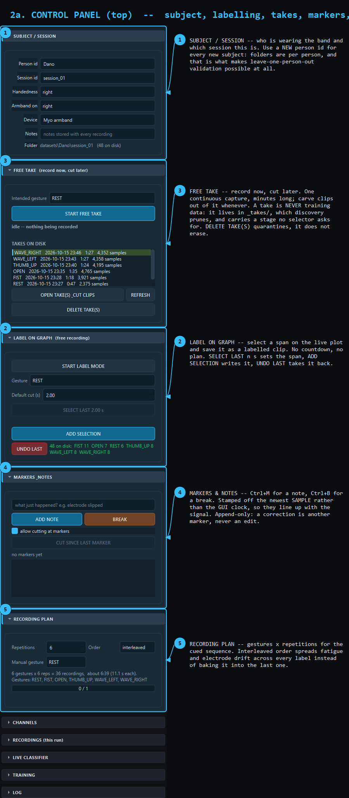
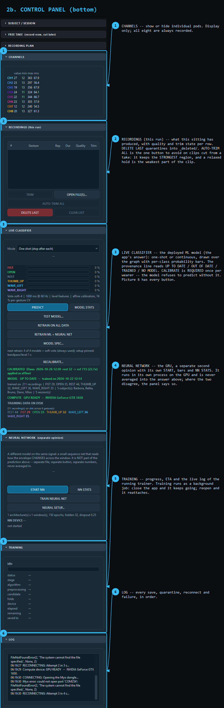
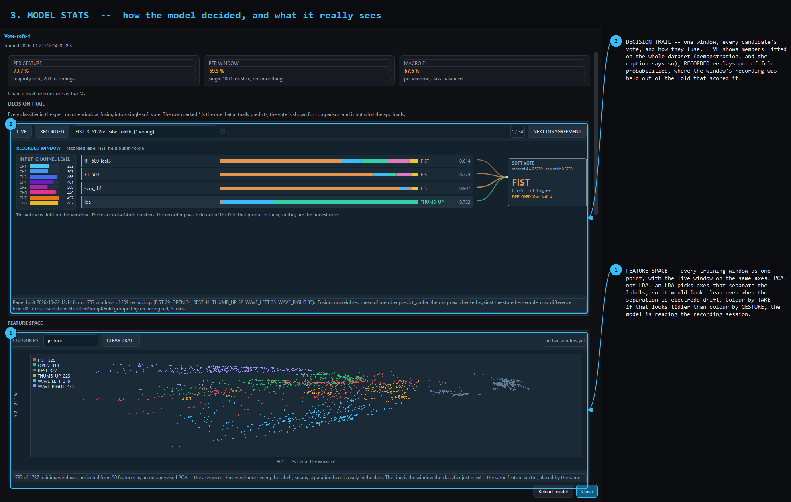
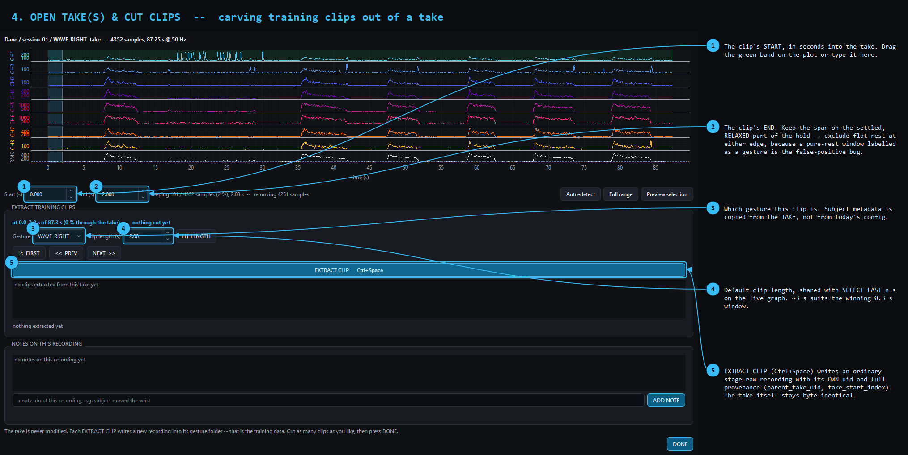
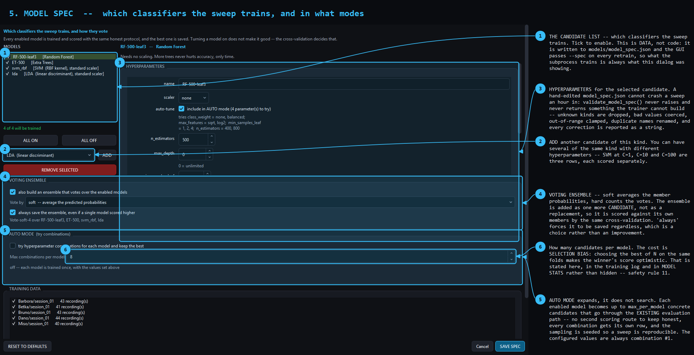
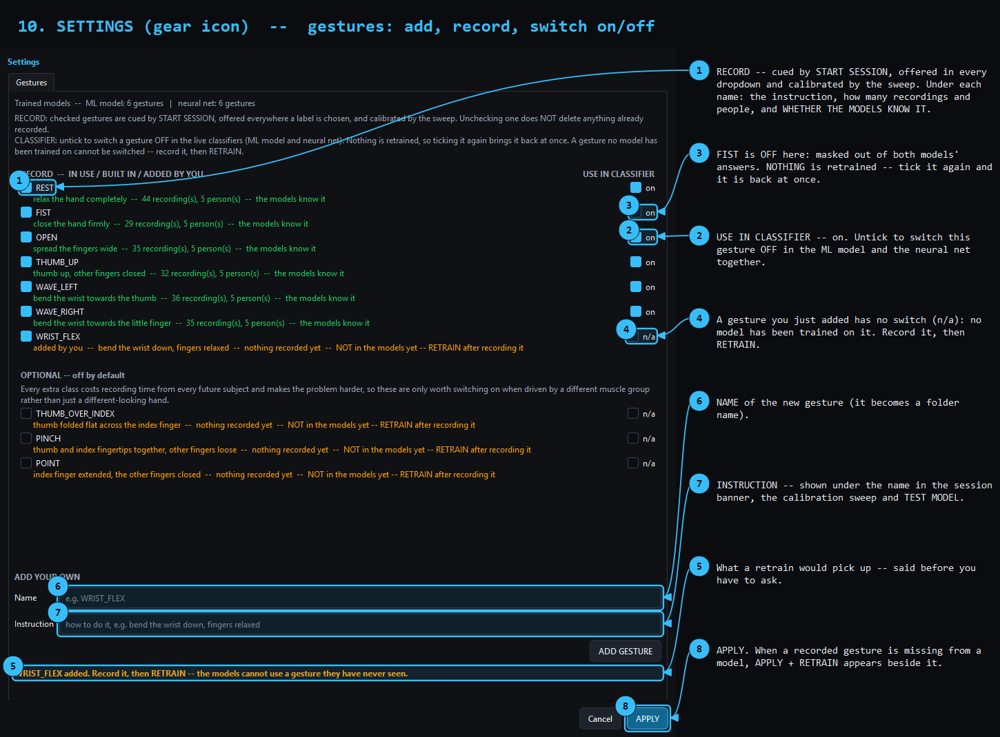

# Myo EMG Gesture Recorder — Complete Manual

**An 8-channel surface-EMG gesture dataset tool for the Thalmic Myo armband,
with the training and validation pipeline that goes with it.**

---

| | |
|---|---|
| **Platform** | Windows 11 · Python 3.14 · PySide6 |
| **Hardware** | Thalmic Myo armband + Bluegiga BLED112 dongle |
| **Application** | `emg_dataset_tool.py` — one file, Qt-free data layer |
| **Trainer** | `train_model.py` — three-stage scikit-learn sweep, CPU |
| **Tests** | 1603 checks across 16 scripts (3 need the armband) |
| **Status** | Mid re-record — see [§11](#11-current-state) |

---

## Contents

**Part I — Getting started**
1. [What this is, and what it is not](#1-what-this-is-and-what-it-is-not)
2. [Requirements](#2-requirements)
3. [Installation](#3-installation)
4. [Your first session](#4-your-first-session)

**Part II — How it works**

5. [Architecture](#5-architecture)
6. [The interface](#6-the-interface)
7. [Recording workflows](#7-recording-workflows)
8. [From recordings to a model](#8-from-recordings-to-a-model)
8a. [The neural network — the separate second opinion](#8a-the-neural-network--the-separate-second-opinion)
9. [The honesty machinery](#9-the-honesty-machinery)

**Part III — The engineering record**

10. [Problems solved, and how](#10-problems-solved-and-how)
11. [Current state](#11-current-state)
12. [Reference](#12-reference)
13. [Troubleshooting](#13-troubleshooting)

---

# Part I — Getting started

## 1. What this is, and what it is not

This is a **recording tool**. The deliverable is a clean, honestly-labelled
EMG dataset that can be validated subject-independently — not a classifier.

That distinction drives every design decision in the project. On this problem
the dataset is the bottleneck and the model is not, and the tooling is built
to make that impossible to forget: every training run prints the
majority-class baseline and a control that re-scores the winner using eight
numbers instead of fifty, so a flattering accuracy cannot pass unchallenged.

**What it does**

- Streams 8 channels of surface EMG at ~50 Hz (filtered) or 200 Hz (raw)
- Records labelled gestures three different ways (cued, free-take, on-graph)
- Checks recording quality, proposes trims, keeps everything recoverable
- Annotates with timestamped markers and notes, without ever touching the data
- Exports combined ML bundles
- Runs a three-stage model sweep with grouped cross-validation
- Predicts live, with per-class probabilities and two diagnostic views

**What it deliberately does not do**

- Ship a trained model (one exists; it is not the point)
- Run the sweep on the GPU — [§10.3](#103-why-the-sweep-does-not-use-the-gpu)
- Delete anything, ever — [§9.5](#95-nothing-is-ever-deleted)
- Quote an accuracy without its confound

---

## 2. Requirements

### Hardware

| Item | Detail |
|---|---|
| Armband | Thalmic Myo, 8 dry EMG pods, firmware `1.5.1970.2` |
| Dongle | Bluegiga BLED112, USB `2458:0001` |
| Port | auto-detected by USB PID; `COM3` on the reference machine |

The `myo64.dll` in the repo is a leftover from the official Myo SDK and **is
not used** — everything goes over the serial protocol in `myo_raw.py`.

### Software

```
Required     pyserial · numpy · PySide6 · pyqtgraph
Training     scikit-learn · joblib
Recommended  pandas (DataFrames, parquet) · scipy
Optional     pyarrow (only if SAVE_PARQUET = True)
             torch   (only train_torch.py, which is retired)
```

**The recorder never imports torch.** It asks a subprocess whether a GPU
exists, so the application starts, records and predicts identically with torch
absent. The import costs ~7 s and attaches a GPU context to a process whose
single job is not to drop samples.

---

## 3. Installation

```powershell
git clone https://github.com/Inszert/emg.git
cd emg
python -m pip install -r requirements.txt
```

`torch` is deliberately **not** in `requirements.txt`: pip's default index
serves the CPU-only build, which `train_torch.py` refuses rather than silently
running twenty times slower. If you want it:

```powershell
python -m pip install torch==2.9.1+cu128 --index-url https://download.pytorch.org/whl/cu128
```

### Verify without hardware

```powershell
python emg_dataset_tool.py --summary     # dataset stats, no GUI, no armband
python tests\test_datalayer.py           # 150 checks
python tests\test_gui.py                 # 109 checks, builds the real window
```

### Verify with hardware

Plug the dongle in, put the armband on, then:

```powershell
python legacy/test_myo.py        # the original reference monitor
```

If traces move, the link works. **Close it before starting the main tool** —
only one process can hold the COM port.

---

## 4. Your first session

1. **Put the armband on.** Wear it snugly on the thickest part of the forearm.
   Wait for the link pill to go green.
2. **Set Person id and Session id.** A new subject gets a **new** person id —
   folders are per person, and that is the entire mechanism behind
   leave-one-person-out validation.
3. **Press `START FREE TAKE`** (`Ctrl+Shift+R`).
4. **Per repetition:** rest ~3 s → make the gesture → let it settle → **hold
   it relaxed for ~4 s at the effort you would actually use** → release.
   Interleave the gestures. About six of each.
5. **`STOP & SAVE TAKE`.**
6. **`OPEN TAKE(S) & CUT CLIPS`** → cut ~3 s clips from the settled part of
   each hold. **Do not press AUTO-TRIM ALL** — [§6.3](#63-the-control-panel--bottom).
7. **`RETRAIN ON ALL DATA`.**
8. **Take the armband off and walk away.** Repeat on another day.

> ### Step 8 is the whole point
>
> A gesture recorded on only one electrode fitting cannot be distinguished
> from that fitting. The classifier will score beautifully and will have
> learned nothing transferable. **Five sittings with the band genuinely
> refitted between them** is what turns a number into a result. This is not
> a theoretical concern — it is the failure this project already made once,
> at a cost of 325 recordings. See [§10.4](#104-data-quality--the-expensive-problems).

**Hold it relaxed**, not maximally. A real gesture is made and then *relaxed
into*. If every recording is an effortful contraction, the relaxed hold you
will actually use lands in a band the model has never seen, and a held
gesture flips to `REST` while your hand is still in the pose.

---

# Part II — How it works

## 5. Architecture

### 5.1 The layering

```
Myo armband
    │  Bluetooth LE
BLED112 dongle on COM3
    │  pyserial
myo_raw.BT                    BLE/BGAPI packet framing
    │
myo_raw.MyoRaw                Myo protocol, set_mode, notifications
    │  add_emg_handler(fn(emg, moving))
MyoAcquisition                background thread, ring buffer, capture
    │  Qt signals (state only) + ring buffer reads
MainWindow                    the GUI
```

**This chain works and must stay working.** Three rules were learned on real
hardware and are load-bearing:

1. **Call `myo.run()` with no timeout argument.** With one, `recv_packet`
   re-assigns `ser.timeout` before *every byte*, and on Windows each
   assignment reconfigures the COM port. Measured: **4.6 Hz instead of 50**,
   followed by the port dying outright.
2. **Only the acquisition thread may touch the serial port.** `BT` shares one
   port and one packet buffer across callers and takes no lock. A `vibrate()`
   write from the GUI thread desynchronised the framing permanently.
3. **Reconnect = a fresh `MyoRaw`.** Reusing a dead instance silently fails to
   stream.

### 5.2 Threading

| Thread | Owns | Rule |
|---|---|---|
| Acquisition | the serial port, the ring buffer, capture | the only writer to the port |
| Watchdog | stall and scan timeouts | force-closes the port to break a blocking read |
| GUI | everything Qt | pulls samples on a timer; never touches serial |
| Trainer | — | a **subprocess**, never a thread |

**GUI pulls, acquisition pushes.** Per-sample Qt signals at 200 Hz would flood
the event loop, so the acquisition thread signals *state* only and the GUI
reads samples on its own timer.

**Training is a subprocess** because scikit-learn with `n_jobs=-1` starves the
acquisition thread — observed: it made the test suite time out — and because a
training crash must not take the recorder down.

### 5.3 Two buffers, on purpose

A **ring buffer** feeds the display; a **separate capture list** feeds
recording. Dropping a display sample is cosmetic; dropping a recorded sample
is data loss. The paths are deliberately not shared.

### 5.4 Module map

Until 2026-10-22 the application was one 21 400-line file. It is now the
`emg_app` package, split by topic; `emg_dataset_tool.py` is still the entry
point and still re-exports every name, so `import emg_dataset_tool as T`
works unchanged. Full map: [`../emg_app/README.md`](../emg_app/README.md).

```
emg_app/config.py        all tunables (read live as cfg.NAME everywhere)
emg_app/utils.py, signal_processing.py, calibration.py, features.py,
        quality.py, markers.py, recording.py, model_spec.py, compute.py,
        dataset.py                                   the data layer (no Qt)
emg_app/acquisition.py + myo/                        the armband      (no Qt)
emg_app/neural.py, jobs.py, sequence.py, model_test.py               (no Qt)
emg_app/decision_panel.py, prediction.py             the live models  (no Qt)
emg_app/gui/            widgets, plot, dialogs/ (one file per dialog),
                        main_window/ (window.py + one mixin per feature)
training/               train_model, train_nn, train_job, explain_votes,
                        nn_arch, nn_serve, nn_ml_comb_test
```

**Everything outside `gui/` is Qt-free and importable headless.** That is
what lets a training script run `import emg_dataset_tool as T;
T.load_dataset(...)` on a machine with no display.

### 5.5 On-disk format

```
datasets/person_01/session_01/
    session_config.json      config snapshot for the session
    manifest.jsonl           append-only, one line per saved file set
    markers.jsonl            append-only, timestamped notes and breaks
    _takes/                  long unlabelled free takes (NOT training data)
    FIST/
        FIST_rep001_20261006-114530-123_a1b2c3_raw.csv
        FIST_rep001_20261006-114530-123_a1b2c3_raw.npz
        FIST_rep001_20261006-114530-123_a1b2c3_raw_meta.json
        FIST_rep001_..._trimmed.csv        (if trimmed)
        FIST_rep001_..._raw_notes.json     (if annotated)
    _graphs/                 exported PNG/SVG
    _deleted/                quarantined recordings (never erased)
```

**Folders beginning with `_` are invisible to discovery.**
`discover_recordings()` runs `dirnames[:] = [d for d in dirnames if not
d.startswith("_")]` at every level of the walk. That one line is what keeps
takes, quarantined files and archives out of training.

Identifying columns are repeated in every CSV row. Redundant, but it makes a
single CSV self-describing and `pd.concat`-able without care.

---

## 6. The interface

> Every arrow in these screenshots was placed from the widget's **real
> geometry** by `tools/make_ui_guide.py`. A renamed control breaks the
> generator rather than producing a picture that points at the wrong thing.
> The model, the decision panel and the take shown are the project's real
> ones. Regenerate with `python tools\make_ui_guide.py . docs\images`.

### 6.1 The main window


Graph left, controls right, banner top, status bar bottom.

**The graph stays live through everything.** Even the review step draws a
finished take over these same eight curves without pausing acquisition.

**The banner is what you watch during a session.** It is oversized on purpose
— during a recording you are looking at your hand, not at a 10 px label.

| Bottom bar | Action |
|---|---|
| `START SESSION` | the cued plan: `REST → GET READY → 3-2-1 → RECORD`, per gesture × repetition |
| `RECORD (manual)` | one take now, outside the plan |
| `SAVE GRAPH` | current view to PNG/SVG in `_graphs/` |
| `EXPORT DATASET` | `.npz` + index CSV + summary into `exports/` |

### 6.2 The control panel — top



Sections fold away by clicking the header. On a laptop they do not all fit,
and scrolling past the one you want is this UI's most common irritation.

- **SUBJECT / SESSION** — a **new person id for every new subject**. Edits are
  mirrored into the module globals, so metadata on disk matches reality.
- **LABEL ON GRAPH** — select a span on the live plot, save it as a clip.
- **FREE TAKE** — record now, cut later.
- **MARKERS & NOTES** — `Ctrl+M` note, `Ctrl+B` break. Timestamped off the
  newest **sample**, not the GUI clock. Append-only: a correction is another
  marker.
- **RECORDING PLAN** — leave the order **interleaved**; it spreads fatigue and
  drift across every label instead of baking it into the last one.

### 6.3 The control panel — bottom



- **CHANNELS** — display only; all eight are always recorded.
- **RECORDINGS (this run)** — `DELETE LAST` quarantines into `_deleted/`.
- **LIVE CLASSIFIER** — four provenance states, never a guess:
  `NO MODEL TRAINED` · `TRAINED on <date>` (no data block) · `UP TO DATE` ·
  `OUT OF DATE`.
- **NEURAL NETWORK (separate opinion)** — a second model with its own
  **START NN** (`Ctrl+Shift+N`), its own probability bars, its own
  **NN STATS** dialog and its own **TRAIN NEURAL NET** button (§8a). It runs
  in a separate process and really does use CUDA; the chip in the panel says
  what the worker is running on, which is a different question from the
  COMPUTE badge's "what hardware exists". **Its output is never part of the
  LIVE CLASSIFIER answer** — what it adds is showing where the two models
  disagree, naming which one the app actually answers with.
- **CALIBRATE… / RECALIBRATE…** (`Ctrl+Shift+C`) — on since 2026-10-16; the
  saved model requires it (§9.1a). **START SWEEP** cues REST and then each
  gesture, judging every capture as it lands and marking any that did not
  register so it can be redone — a single squeeze leaves most channels quiet
  and would set their scale from almost nothing. A quick rest+squeeze path and
  an offline `DERIVE FROM RECORDED DATA` path are also there. Readiness is
  judged on the age of the newest **sample**, shown live, because a connected
  armband that has gone to sleep supplies none.
  Measures the wearer in the SUBJECT box: three seconds relaxed, three
  seconds clenched, two levels per channel, stored with that person and valid
  until you press RECALIBRATE. It also works with no armband
  (`DERIVE FROM RECORDED DATA`). Its status line has five states and exactly
  one is true: `NOT CALIBRATED` · `CALIBRATED -- not applied` (a record
  exists, the mode is off) · `CALIBRATED` · `CALIBRATION REFUSED` (with the
  reason) · `CALIBRATION OFF`. GUIDE.md has the how-to; §9.1a has why it is
  off.
- **TRAINING** — `RETRAIN` runs on the **CPU** even when the GPU badge is
  green. sklearn has no GPU backend, and both the tooltip and the dialog say
  so in words.

> ### ⚠️ Do not press AUTO-TRIM ALL on clips cut from a take
>
> `detect_activity` keeps the **strongest** region by design — "a 150 ms
> explosive burst must beat a second of drift" — and in the relaxed-hold
> protocol the hold is the **weakest** part of the clip.
>
> Measured on 17 real relaxed-hold clips: it kept a median of **70.8 %**,
> worst case **42.4 %**, and in **16 of 17** the discarded part was weaker
> than the kept part (ratios 0.28–0.65, at amplitudes of 50–90 — precisely
> the band the protocol exists to capture).
>
> It is also **unnecessary**: a clip cut from a take has the whole clip as its
> label window, and `make_windows()` trains on exactly that span. **Your
> selection already is the trim.**

### 6.4 MODEL STATS



Not modal, on purpose: the trail follows the live classifier, and a modal
dialog would mean you could only watch it if `PREDICT` were already running.

**DECISION TRAIL** — one window, every candidate's vote, and how they fuse.

| Mode | What it is | Honest? |
|---|---|---|
| **LIVE** | stored members, fitted on the whole dataset, run on the window you just made | **No** — a demonstration of how the vote forms. The caption says so every time. |
| **RECORDED** | out-of-fold probabilities captured during training | **Yes** — the window's recording was held out of the fold that scored it. |

The fusion rule is **measured, not claimed**: `build_decision_panel()` computes
the unweighted mean of member probabilities itself, compares it against the
stored `VotingClassifier` over the whole dataset, and records the difference
(measured 1.2e-07 — float32 rounding).

**FEATURE SPACE** — every training window as a point, live window on the same
axes.

It is a **PCA, not an LDA.** An LDA picks axes that separate the labels, so an
LDA scatter looks beautifully separated even when the separation comes from
electrode drift rather than from the gesture — it would flatter the model by
construction. PCA never sees the labels.

| Colour by | Question |
|---|---|
| gesture | do the labels form their own clusters? |
| **take** | …or do the clusters follow the recording session? **If this looks tidier than "gesture", the model is reading the block.** |
| amplitude level | where the effort sits, and the gap a relaxed hold falls into |

The **take** colouring is the single most useful diagnostic in the application.

### 6.5 Cutting clips out of a take



**Where to put the span:** start just after the signal has clearly risen, end
before the release. Keep it on the settled, **relaxed** part of the hold.
Exclude flat rest at either edge — a pure-rest window labelled as a gesture is
how you get false positives firing while the hand sits still.

**How long:** ~2.5–3 s. At the winning setup (0.3 s windows, 0.75 overlap)
that is 30–37 training windows. Longer does not buy more data — windows are
deduplicated against the source timeline anyway — it just drags in ramp.

| Clip length | Training windows |
|---|---|
| 2.0 s | 23 |
| 2.5 s | 30 |
| 3.0 s | 37 |

Each `EXTRACT CLIP` (`Ctrl+Space`) writes a stage-`raw` recording with its
**own** uid and full provenance. Its own uid matters: twenty clips sharing the
take's uid would look like twenty versions of one recording. The take stays
byte-identical.

### 6.6 MODEL SPEC



`Ctrl+Shift+M`. **Which classifiers the sweep trains is data, not code** —
written to `models/model_spec.json`, and the GUI passes `--spec` on every
retrain so the subprocess always trains what this dialog was showing.

The split matters: the schema, the validation and `describe_estimator()` are
Qt-free **and** sklearn-free, and only the trainer turns a spec entry into an
estimator. There is exactly one definition of what a spec means, and the app
runs without scikit-learn installed.

| Control | Behaviour |
|---|---|
| candidate list | tick to enable; several of one kind with different hyperparameters are separate rows, each scored separately |
| **VOTING ENSEMBLE** | added as one more *candidate*, not a replacement, so it is scored against its own members. `soft` averages probabilities, `hard` counts votes. "Always save" is a choice, not an improvement. |
| **AUTO MODE** | expands, does not search — each model becomes up to `max_per_model` concrete candidates through the *existing* evaluation path |

> **AUTO mode's cost is selection bias**, and it is stated rather than hidden:
> choosing the best of N candidates on the same folds makes the winner's score
> optimistic. It appears in the dialog, the training log and MODEL STATS.
> Leave-one-subject-out is the number that did not pick its own folds.

`validate_model_spec()` is the gate, and it **never raises and never returns
something the trainer cannot build** — so a hand-edited `model_spec.json`
cannot crash a sweep an hour in. 346 checks cover it.

### 6.7 SETTINGS (the gear icon)



`Ctrl+,`. One tab so far: **Gestures**. Each gesture has two switches, kept
separate on purpose:

| Switch | Decides | Retrain? |
|---|---|---|
| **RECORD** | what the session cues, what every label dropdown offers, what the calibration sweep covers | never |
| **USE IN CLASSIFIER** | whether the live ML model *and* the neural net may answer with it | **never** — it is a mask on their output |

The mask (`emg_app/class_mask.py`) zeroes the switched-off gesture's
probability and renormalises the rest, **after** the model has answered and
**before** smoothing. Nothing on disk or in a model changes, so switching a
gesture back on restores the original answers exactly. It is saved with the
gesture set in `datasets/gestures.json`.

It is *not* the answer a model trained without the gesture would give: if the
person does a gesture that is off, the panel shows `?` or warns that only a
small share of the model's own probability was on the gestures that are on.
A gesture no model was trained on cannot be switched (`n/a`) — **ADD**, record,
**RETRAIN**. Full account: `CLAUDE.md` §7a; 121 checks in
`tests/test_class_mask.py`.

### 6.8 SETTINGS -> Models, Training, General

`Ctrl+,` opens SETTINGS; besides Gestures (6.7) it has three more tabs. Full
description with screenshots: [UI_GUIDE.md](UI_GUIDE.md) sections 10b - 10d; what
each feature does and how to turn it off: [FEATURES.md](FEATURES.md).

* **Models** -- the model zoo with stars, sizes and soft voting. Off by default
  (the original deployed models are used). `python training/train_zoo.py all`
  builds the zoo.
* **Training** -- augmentation and adaptation to the person, per family. They
  affect training only; defaults come from the ablation study.
* **General** -- the calibration question before PREDICT / START NN and the
  retrain question at startup.

Everything is saved in `datasets/app_settings.json` and restored at startup.

---

## 7. Recording workflows

Three independent paths.

### 7.1 Free take — record now, cut later *(the one in use)*

```
START FREE TAKE (Ctrl+Shift+R)   one continuous capture, minutes long
STOP & SAVE TAKE                 -> <session>/_takes/
OPEN TAKE(S) & CUT CLIPS         carve labelled clips out, any time later
    EXTRACT CLIP (Ctrl+Space)      -> an ordinary stage-raw recording
    NEXT >> (Ctrl+Right)           -> step one clip length along
```

> **A take is never training data, and two independent mechanisms enforce
> it.** It lives in `_takes/`, which discovery prunes, **and** it carries
> stage `take`, which no stage selector asks for. Belt-and-braces
> deliberately: a single guard that silently fails looks exactly like a guard
> that works. Both are checked in `tests/test_free_take.py` (255 checks).

A free take does not go through `SequenceController` — no plan, no countdown,
no review. It calls `start_capture()` directly with a `max_seconds` override,
because the 120 s `MAX_RECORDING_SECONDS` valve is sized for a cued take. The
acquisition thread has **one** capture slot, so a take and the sequence can
never run at once.

### 7.2 Cued sequence

```
START SESSION
  └─ for each (gesture, repetition):
        REST       relax
        PREPARE    "GET READY: FIST"
        COUNTDOWN  3 · 2 · 1        ← capture opens PRE_GESTURE_MS early
        RECORDING  "RECORD NOW"     ← label window opens
        STOPPING   POST_GESTURE_MS  ← label closed, buffer still running
        REVIEW     graph freezes, proposed cut drawn, waits for you
```

**The capture window is wider than the labelled window.** An early reaction or
an overshooting explosive contraction is still inside the raw file; the label
boundaries are stored as metadata rather than by cropping. Nothing is cut at
record time, which makes a labelling mistake *recoverable* instead of
permanent.

### 7.3 Label on graph

Select a span on the live plot and save it. No countdown, no plan.
`LABEL_DEFAULT_SELECTION_S` is the shared default cut length.

### 7.4 Markers, at any time

`Ctrl+M` note · `Ctrl+B` break · `Ctrl+Shift+Space` cut since last marker.
Any marker inside a saved span is copied into that recording's metadata.

---

## 8. From recordings to a model

### 8.1 The data path

```python
import emg_dataset_tool as T

recs = T.load_dataset("datasets", stage="prefer_trimmed")
X, y, groups, meta = T.make_windows(recs)        # (n, win, 8), labels, persons
feats, names = T.make_feature_matrix(X, meta["fs"])

for train, test, held_out in T.leave_one_person_out(groups):
    ...
```

`groups` is the whole point.

### 8.2 Resampling and features

Everything is resampled to **`MODEL_FS = 60 Hz`**. The stream is 28–70 Hz and
unevenly sampled, so a fixed sample count would mean a varying real duration.
Applied identically in training and in `LivePredictor`.

**Two feature families, and `level` is the default.** The `filtered` stream is
already a rectified envelope. `extract_features()` median-centres each
channel, which is right for raw bipolar EMG and **deletes the activation level
here** — measured Fisher ratio 25.5 (level) vs 15.1 (centred), and switching
moved accuracy from 33.5 % to 43.2 % on half the features.

**One feature function, shared.** `model_feature_vector()` is called by both
the trainer and `LivePredictor`. If those drifted apart by one feature, live
predictions would be garbage while the cross-validation score stayed perfect —
the hardest class of bug to notice. A model whose feature count disagrees with
its declared `feature_set` is **rejected at load time**.

### 8.3 Representations

| Name | What it does |
|---|---|
| `raw` | the envelope as it arrives |
| `normalized` | amplitude divided out — expected to matter across subjects |
| `envelope` | smoothed |
| `bandpass` | zero-phase Butterworth, hand-written, no scipy |

**The band-pass is zero-phase, and that is not a nicety.** A causal filter
delays the envelope, and a delayed envelope moves a gesture's onset relative
to the `label_start_index` it was cut with — it would shift the label
boundaries the whole dataset is built on.

**`filtered` gets a low-pass only (8 Hz), deliberately.** The Myo band-passes
and rectifies on-device, so what arrives is already an envelope; at ~50 Hz the
Nyquist limit is ~25 Hz, making a textbook 20–450 Hz band unrepresentable;
and a high-pass on an envelope deletes the DC *activation level*, which this
project measured as harmful twice.

**A cutoff at or above Nyquist is skipped with a reason, never clamped.**
Clamping 450 Hz down to 24.9 Hz would apply a completely different filter and
still call it 20–450 Hz.

### 8.4 The three-stage sweep

The sweep went from a measured **3 h 16 m to ~14 min**:

| Change | Effect | Accuracy cost |
|---|---|---|
| `DEDUPE_WINDOWS` | 5 598 → 2 425 windows | **negative** — it removes a leak |
| identical `EXCLUDE_SETS` folded | 360 → 120 setups | none; it was the same computation three times |
| stage A1 screens on a fraction | ~0.7 s/setup | none; A1 scores are never quoted |
| `A2_SHORTLIST = 32` | 14× fewer expensive probes | **0.02 points**, measured |

**Window-level dedup is correctness, not speed.** Clips cut from a take tile
it with ~50 % overlap, and grouping CV by recording uid does *not* separate
them because every clip legitimately owns its uid. Without dedup the same
samples sit in train and test. `dedupe_windows()` maps each window's centre
onto the timeline it was cut from and keeps the first per step-sized bucket —
exactly windowing each source timeline once.

**A1 rows are never mixed with A2/B rows**, because they are measured on half
the windows. They go to the report under `screen`, and `cost_controls` records
how the sweep was cut down, so a fast run cannot be mistaken for an exhaustive
one.

---

## 8a. The neural network — the separate second opinion

Added 2026-10-19. A small sequence network, trained on the GPU, that reads how
the envelope **changes** across the window instead of summarising it into
statistics. It has its own trainer, checkpoint, process, START button,
probability bars and statistics dialog — and its output never reaches the
app's answer.

```
nn_arch.py     five architectures; imports torch and nothing else
train_nn.py    the sweep -- train_model.py's protocol, its own output
nn_serve.py    the live worker; the only process that imports torch
```

### Why it is kept separate

Two independently validated models that disagree are informative. One blended
number that hides which half was wrong is not. So the separation is enforced
three ways rather than promised:

1. **a different process** — `nn_serve.py` holds the net, and the recorder
   talks to it one JSON line at a time over stdin/stdout. That is primarily
   about the no-torch invariant (§5), but it also means the net cannot reach
   into the classifier's state;
2. **a different type** — the engine yields `NeuralPrediction`, never
   `Prediction`. The two carry nearly the same fields, which is exactly why
   they are different classes: with one type a net answer could be appended to
   the classifier's smoothing history or drawn in its bars by a single
   misplaced line;
3. **different everything else** — its own file, timer, smoothing window,
   button and dialog. The net deliberately does *not* claim the graph overlay,
   because two labels fighting over one corner of the plot is the exact
   blurring this design prevents.

The panel does show where the two **disagree**, naming which one the app
actually answers with. `tests/test_nn.py` spends its first thirty checks on
exactly these properties, reading the code with comments and string literals
tokenised out so that a docstring explaining the rule cannot be mistaken for a
breach of it.

### It uses CUDA; the recorder still never imports torch

`NN_DEVICE = "auto"` resolves inside the worker. Measured on this machine: the
worker comes up on `cuda:0` (GTX 1650, torch 2.9.1+cu128) and one live window
costs **24.3 ms round trip, of which 7.7 ms is the forward pass**, against a
150 ms budget — and the panel prints that measurement next to the budget
rather than asserting it fits. `tests/test_no_torch.py` still passes 11/11
with the net enabled.

The net's device chip answers a different question from the COMPUTE badge: the
badge says what hardware exists, the chip says what the worker is really
running on, and it reads `NN DEVICE --` until the worker reports.

### The architectures

Five candidates; the ranking is measured, not asserted. The default — first in
the grid, and what `--quick` takes — is `tcn`: three depthwise-separable
dilated conv blocks (dilations 1/2/4) plus attention pooling, **3 943
parameters**. The input is 18–30 time steps and the dataset is ~1 700 windows
from two wearers, so reaching across the window should cost parameters
logarithmically in its length rather than linearly in hidden units, and
depthwise separation buys the same receptive field for a third of the weights.

**Attention pooling, not the last time step.** The retired experiment fed
`out[:, -1, :]` to the head, which asks the net to compress a gesture into
whatever state it happens to hold at an arbitrary window boundary. The pool
learns a weight per step and returns the weighted mean *concatenated with the
plain mean*, the second half keeping the activation level — removing the level
is the mistake this project has measured twice. `lstm` and `cnn` keep the old
heads deliberately, as the historical baseline.

| arch | window | per window | per gesture | params |
|---|---|---|---|---|
| **`cnn_gru`** (saved) | 0.50 s | **57.5 % ± 1.9** | 55.3 % | 6 503 |
| `tcn` | 0.50 s | 54.3 % | **58.8 %** | **3 943** |
| `gru` | 0.50 s | 47.5 % | 50.6 % | 4 455 |
| `lstm` | 0.30 s | 42.9 % | 44.7 % | 14 022 |
| `cnn` | 0.50 s | 39.6 % | 34.1 % | 18 246 |

Subject-grouped, 85 recordings, two wearers, `affine` calibration, 433 s on
the GPU. Majority class 17.6 %. The conv front end matters — both top rows
have one, and both bare recurrent nets lose to it — but a GRU on top of it
beat the pure dilated stack on windows, while `tcn` won the per-recording vote
with 1.6× fewer parameters.

### The result: it loses to the LDA by 29 points

| | per window | per gesture | macro F1 | input |
|---|---|---|---|---|
| **LDA-shrinkage (deployed)** | **86.8 %** | **87.1 %** | **83.2 %** | 154 features |
| NN-cnn_gru (separate) | 57.5 % | 55.3 % | 47.6 % | 30 × 8 samples |

Both subject-grouped on the same recordings with the same calibration, so they
are comparable. This repeats the 2026-10-14 finding with a better-specified
experiment behind it, and it is why the net is a diagnostic rather than a
deployment: nothing here argues for shipping a 200 MB torch dependency to an
SBC.

Two numbers in NN STATS are worth reading anyway:

- **the DC-only control** — the identical net with every window flattened to
  its eight channel means scores 47.3 % against 57.5 %, so the temporal
  structure is worth **+10.2 points**. The net is reading the right thing;
  there simply is not enough of it in eight channels of envelope at 50 Hz to
  beat good hand-crafted features on a thousand windows;
- **the protocol gap** — 95.6 % recording-grouped against 57.5 %
  subject-grouped, a **38.2-point** gap where the deployed model's is 11.4.
  The net has ample capacity for this problem and spends it memorising the
  wearer. More wearers is what would close that, and it is the one concrete
  reason to revisit this later.

### Sharing the protocol, and not sharing the features

`train_nn.py` imports `source_timeline`, `dedupe_windows`,
`subject_grouping_viable`, `resolve_grouping`, `load_recordings` and
`person_vector` **from `train_model`**, so the two trainers cannot drift into
measuring different things. It inherits window-level dedup, subject-grouped
fold selection, per-wearer calibration, leave-one-subject-out, the
majority-class baseline and the `PROGRESS`/`TRAINEVENT` lines — so one GUI
panel and one parser serve both trainers.

What is deliberately *not* shared is the feature function.
`model_feature_vector()` is the contract binding `train_model.py` to
`LivePredictor`; a net learns its own features and must not be mixed into that
path. The net's contract is `nn_input_block()` — resample, calibrate, cast to
float32, stop — and the worker calls the same function. Scaling (`log1p` +
per-channel standardise) is fitted on the training fold only and ships inside
the checkpoint, because at inference the scaler is part of the model.

### The statistics sidecar

`train_nn.py` writes `models/gesture_nn.json` beside the checkpoint:
everything except the weights. The application **cannot** read its own net's
metrics out of the `.pt`, because that is a torch pickle and the recorder does
not import torch. So NN STATS reads the sidecar, which is what lets the dialog
work with the net stopped, with no GPU, and on a machine where torch was never
installed. The sidecar carries the same `data` provenance block both trainers
emit, so the net answers "trained on what, and is it current?" exactly as the
model does.

### The refusals

No checkpoint → START NN refuses and names `train_nn.py`. A calibrated net
with an uncalibrated wearer → refused **before a subprocess is spawned**,
because there is no point attaching a GPU context to discover the wearer has
not calibrated. The worker disagreeing with the sidecar about the calibration
mode → the checkpoint wins, because the weights are the fact and the sidecar
is a convenience that can be stale. A probability vector of the wrong width →
the whole engine is refused rather than one window mislabelled. A window the
worker cannot use → one error line with `fatal: false`, and the engine keeps
going. `load_state_dict(strict=True)` → a shape mismatch raises rather than
leaving layers at their initialisation.

### Two bugs worth remembering

**The scaler shape bug that only the inference path could hit.**
`fold_scaler` returned `mean`/`std` with `keepdims=True`, shape `(1, 1, 8)`.
That broadcasts correctly against the trainer's batched `(n, win, 8)` — so
every training run passed — but turns a single live `(win, 8)` window into
`(1, win, 8)`, which reaches `conv1d` as a 4-D tensor and raises. No training
run can find it. Both sides now use a per-channel `(8,)` vector, and the
worker flattens whatever it finds so earlier checkpoints still load.

**A refusal that resolved the wrong way round.** `_load_calibration()` always
re-read the mode from the sidecar, so when the worker's checkpoint tried to
override it, the sidecar's answer went straight back. The mode is now passed
in explicitly.

---

## 9. The honesty machinery

The part worth reading. The project assumes any good-looking number is wrong
until proven otherwise, and the tooling enforces that rather than relying on
anyone's memory.

### 9.1 The DC-only control

Every training run re-scores the winner using **only the 8 per-channel mean
levels** — no shape, no spectrum, no timing — and prints how much the other
features added. Under 5 points of gain it prints a warning naming the
confound. Both numbers go into the sweep report and the saved payload.

If 8 numbers score as well as 50, nothing has been learned about gestures.

**The control is scored on the winner's own split key** (fixed 2026-10-16).
It used to be scored recording-grouped while the winner was scored
subject-grouped, which made the subtraction compare two different protocols
and print a *negative* gain. It now takes `split_groups`, states which
protocol it used, and records that protocol next to the number
(`confound.dc_only_control.grouping`) so a report cannot be read as comparing
like with like when it is not.

### 9.1a Per-wearer calibration — on, and what it does and does not buy

Calibration (`CALIBRATION_MODE`, §6) maps each wearer onto a common scale
from two measured levels per channel. It shipped off, was measured by three
full sweeps and a leak gate, and is now `"affine"`: **81.3 % → 86.5 %** per
window, and 80.4 % → 88.2 % on the per-gesture vote, on a wearer the model
has never seen — with that wearer's calibration fitted on recordings left out
of the scoring, so the transform did not set its own exam. Three things have to be said next to that
number, and the tooling says all three on every run:

* A calibrated cross-wearer score is **not zero-shot**. The held-out wearer's
  own unlabelled signal set their gain, so it answers "how well does this
  work on a new wearer *who calibrates first*". That is a real deployment,
  but a different question, and the trainer prints the distinction every
  calibrated run.
* Calibration is a **between**-wearer correction and the dataset's main
  confound is **within** a wearer (one take per gesture per person), so it
  does not fix it. Measured: the within-wearer contrast moved 97.8 % → 98.2 %
  — nothing. More sittings per wearer is still the fix.
* **A rising DC-only control is not progress.** The `gain` mode lifted that
  control by 20 points (54.4 % → 74.3 %) while leaving the real score flat:
  it made the eight channel means transfer between people, which is not
  learning anything about gestures. §8h said to read a high cross-subject
  DC-only score that way; `gain` is that effect produced on purpose.

**Method note, learned the hard way here.** A fixed-setup A/B — swapping
calibration in underneath the previous winner's preprocessing — said it was a
wash. It was the wrong measurement: calibration changes which preprocessing
and which feature family is best, so it has to be compared by re-running the
sweep. Both numbers are in CLAUDE.md §8k, the wrong one kept deliberately.

A bad calibration is refused rather than coerced, and a model refuses to
predict on a scale it was not fitted on, for the same reason a mismatched
decision panel is refused: the failure would otherwise be confident output,
not an error.

### 9.2 Both validation protocols, always

With one subject, folds group by recording. With two or more they switch to
**subject-grouped automatically** — because otherwise the sweep *selects* a
setup that leans on one person's absolute amplitudes, which is the opposite of
what collecting more people is for. `leave_one_subject_out()` already reported
the honest number, but it ran *after* the winner was chosen, so it could only
document a bad choice rather than prevent it.

The winner block prints the chosen protocol and the other as contrast, and
warns when they disagree by more than 5 points.

### 9.3 Selection never flatters

The model spec decides what gets **trained**, never how it is **scored**.
Every candidate — hand-written, voted or AUTO-generated — goes through the
same cross-validation. Where selection bias exists (AUTO mode), it is stated
in the dialog, the training log and MODEL STATS rather than hidden.

### 9.4 The GPU badge never guesses

Until the subprocess probe answers, the badge reads `checking…` — never a
guess in either direction. "The probe did not answer" is reported as a
*different* thing from "no GPU". And because the sklearn sweep has no GPU
backend, both the tooltip and the RETRAIN dialog say in words that RETRAIN
runs on the CPU even when the badge is green.

### 9.5 Nothing is ever deleted

Eleven invariants. Breaking one is a bug, not a trade-off.

1. **Raw is written once and never rewritten.**
2. **Nothing is overwritten** — every write goes through `unique_path()`.
3. **Trimming creates new files** with a new stage suffix.
4. **Deleting quarantines into `_deleted/`** — never `os.remove`.
5. **Bad recordings are flagged, never discarded.**
6. **Samples are captured on the acquisition thread.**
7. **Every file gets a config snapshot.**
8. **Annotating never edits data** — sidecars and append-only logs.
9. **A free take is never training data.**
10. **No fake predictions.**
11. **Selecting a model never flatters it.**

---

# Part III — The engineering record

## 10. Problems solved, and how

A condensed version of [`../problems.md`](problems.md), which carries every
entry with its verdict. Verdicts: **SOLVED** (root cause removed) ·
**MITIGATED** (cause not removable, symptom handled) · **WORKAROUND** (the
broken path is avoided, not fixed) · **ACCEPTED** (real, understood, left
alone).

### 10.1 The link

By far the worst area of the project, and almost every problem in it looked
like a different problem than it was.

#### Gestures arriving ~8 seconds late, while the sample rate looked perfect

You clench your fist, the graph does nothing, and seconds later the burst
appears — with the rate readout still reading 50 Hz.

**Why it was hard to see:** a *constant* delay does not change the spacing
between samples. Every rate estimate was correct and every sample was present;
they were just all old. The delay sat in the OS serial buffer, where nothing
in the app was looking.

**Cause:** `recv_packet()` reads **one byte per `ser.read()`** and re-assigns
`ser.timeout` around it. That reader only just keeps up with a 50 Hz
8-channel stream, so any hiccup left a backlog it could never drain.

**Fix:** `MYO_BULK_READ` reads everything waiting in one `ser.read(in_waiting)`
and feeds `myo_raw`'s own byte parser; `MYO_FLUSH_ON_START` drops the connect
handshake; `MYO_MAX_BACKLOG_BYTES` watches the backlog itself. A `lag` readout
was added to the status bar so this can never be invisible again.

**SOLVED** — but knowingly not ideal: it *bypasses* `myo_raw`'s read loop
while still using its parser, so there are now two ways to pump the port.
Repairing `recv_packet()` upstream was rejected on purpose, because
`myo_raw.py` is the one layer known to work.

#### 4.6 Hz, then "A device attached to the system is not functioning"

**Cause:** calling `myo.run(1)` instead of `myo.run()`. With a timeout,
`recv_packet` reconfigures the COM port **before every byte** — thousands of
reconfigurations per second, until Windows gave up on the port.

**SOLVED** by calling `run()` with no argument. The fix is correct and
*load-bearing and invisible*: a one-character "improvement" re-breaks the
whole tool, and the failure mode is a slow stream rather than an exception.
Three separate mitigations exist only because of it.

#### The link dropped every couple of minutes

**Three independent causes**, which is why single fixes kept half-working: the
armband sleeps on its own and streaming EMG does not keep it awake; the BLE
supervision timeout is 640 ms, short enough that a hand over the dongle kills
the link; and the connection interval had to stay at the Myo default.

**MITIGATED → effectively solved** by `MYO_NEVER_SLEEP`,
`MYO_CONN_TIMEOUT_MS = 3000` and `MYO_CONN_INTERVAL_MS = 7.5`. The biggest
quality-of-life improvement in the project. Cost: never-sleep **burns
battery**, and a flat battery produces the same symptom as the original bug.

#### EMG just stops — no error, no exception

A sleeping or disconnected armband is **silent, not faulty**, and after the
`run()` fix the stream thread is blocked in a bare serial read and cannot time
out to check.

**MITIGATED** by a watchdog thread ticking every 250 ms; after
`STALL_TIMEOUT_S = 6.0` it force-closes the port, converting the blocked read
into an exception the reconnect loop already handles. A 6-second blind spot by
construction — lowering it risks tearing down a healthy link over a normal BLE
gap.

#### "data with unknown attr" garbage mid-session

**Cause:** a `vibrate()` write **from the GUI thread**. `BT` shares one port
and one packet buffer and takes no lock, so a second thread's write lands
mid-packet and the framing never recovers.

**SOLVED** by queueing haptics: `vibrate()` only sets a flag, and the
acquisition thread performs the write between two packets. The *pattern* is
right; the enforcement is a **convention, not a mechanism** — `myo.bt.ser` is
still reachable from anywhere, so the next feature could reintroduce it.

#### Sample rate reported as 9258 Hz for a 57 Hz stream

**Cause:** estimating the rate as `1/median(diff(t))`. The dongle delivers 2–4
buffered packets at once, so the median interval is an **intra-burst**
interval. Measured over 8061 intervals: median 20.6 ms, p95 28.0 ms — the mean
rate is an honest 49.9 Hz, but almost no sample arrives on time.

**SOLVED** by `measured_rate()` using the **span average**. Cheap to re-break,
so it carries its own warning.

Also in this section: a scan that hung forever (bounded by `SCAN_TIMEOUT_S`),
5–10 s reconnects (`MYO_FAST_RECONNECT` skips the scan — measured ~1 s), dead
`MyoRaw` objects that cannot be reused, a console flooded 200×/s in raw mode,
and `vibrate()` raising `NameError` because of a Python-2 `xrange`.

### 10.2 Recording and data integrity

| Problem | Fix | Verdict |
|---|---|---|
| The gesture happening outside the labelled window | capture window **wider** than the label; boundaries stored as metadata, not by cropping | SOLVED — makes a labelling mistake recoverable |
| **Scrolling a panel silently changed recording settings** | `WheelGuard` event filter: a wheel event over a combo/spin/slider is accepted only when it has keyboard focus | SOLVED — a data-integrity bug, not a UI nuisance |
| A five-minute take becoming one "gesture" | two independent guards: `_takes/` is pruned by discovery **and** stage `take` is asked for by nobody | SOLVED |
| Twenty clips looking like twenty versions of one recording | each clip gets its **own** uid; provenance moves to metadata | SOLVED |
| Annotating touching the recording | notes to a `*_notes.json` sidecar; marker log append-only | SOLVED |
| Auto-trim cutting a gesture in half | strongest region wins, `TRIM_MIN_INACTIVE_MS` bridges a two-phase dip, operator always sees the proposed cut | **PARTIAL** — thresholds are subject-dependent; see the AUTO-TRIM warning in [§6.3](#63-the-control-panel--bottom) |

### 10.3 Application and tooling

**PyQtGraph's SVG exporter crashes on these plots** (`ValueError: not enough
values to unpack` in `correctCoordinates`). SVG goes through Qt's own
`QSvgGenerator` instead — a **WORKAROUND**, and the right one: it produces a
true vector file and lets the caption be embedded in the SVG header.
"Simplifying" it back is explicitly forbidden.

**Training starved the acquisition thread and hung the test suite.** sklearn
with `n_jobs=-1` saturated every core. **SOLVED** by running training as a
subprocess — which fixes the starvation *and* the blast radius with one
decision.

**The GUI retrained on, and overwrote, the wrong dataset and model.** A changed
`DATA_FOLDER`/`MODEL_PATH` meant the trainer silently used its own defaults.
This actually happened in testing. **SOLVED** by passing `--root`, `--out-dir`,
`--model-path` and `--spec` explicitly on every retrain.

**A hand-edited `model_spec.json` could crash a sweep an hour in.**
**SOLVED** by `validate_model_spec()`, which **never raises and never returns
something the trainer cannot build**: unknown kinds dropped, bad values
coerced, out-of-range clamped, duplicates renamed, and a spec with everything
disabled gets one model switched back on. Every correction is reported as a
string. 346 checks cover it.

#### Why the sweep does not use the GPU

Asked and answered. RAPIDS cuML is the only GPU implementation of these
algorithms, and every wheel is **manylinux** + **cp310–cp312**; this machine
is `win-amd64` on Python 3.14. Two independent blockers. Even if it installed,
the data is far too small — the worst setup is ~6300 windows × 154 features,
and GPU tree/SVM kernels start winning around 10⁵ rows.

What *did* make it faster, measured:

| Change | Effect |
|---|---|
| `probability=False` while scoring | **5.7×** on every SVM fit (54.26 s → 9.52 s) |
| CV folds on threads | ~1.3–2.9× on single-threaded estimators |
| ~~`SVC(cache_size=1000)`~~ | **nothing** — 7.22 s vs 7.21 s. Predicted win, measured nothing, dropped |

The SVM change matters: `probability=True` makes libsvm run its own internal
5-fold CV to fit a Platt sigmoid, and `evaluate()` only ever calls `predict()`.
The trap is that soft voting picks members by `hasattr(clf, "predict_proba")`,
so sharing those pipelines with the ensemble would have **silently dropped the
SVM from the vote**. The ensemble is built from its own always-probability
copies.

### 10.4 Data quality — the expensive problems

> The link problems cost days. These cost a **dataset**.

#### 43 % on six gestures, and it was the data

72 recordings, one subject. Best result ≈43 % per window against 16.7 %
chance. Not the model: **15 of 72 recordings were flagged `no_activity`**, and
FIST's mean envelope varied **26-fold across its own repetitions**.

Model tuning was stopped. The honest conclusion was reached instead of chasing
it with bigger models.

#### Rest was louder than the contractions, and quality control passed it

Median total activation: `REST` **451**, `FIST` **208**. **83 % of all
non-REST windows sat below REST's own 90th percentile.**

Two causes. The session's resting baseline was ~130 counts against 24 in a
good session — loose band or poor contact. And `check_quality()` flags a
recording that never exceeds `QC_MIN_PEAK_AMPLITUDE`, which is **40 counts,
absolute** — a 130-count baseline clears 40 on its own, so every bad recording
**passed**.

**OPEN.** The fix is specified — a contrast check relative to the session's
own rest, plus a live "× rest" readout, because a subject who can see
"1.2× rest" will squeeze harder while one reading raw counts has no idea
anything is wrong. **Until it ships, the next dataset can fail the same way,
silently.**

#### 99.7 % accuracy that means almost nothing

A CUDA CNN-LSTM scored 99.7 % per window on the FIST/REST set. The grouped
cross-validation is sound, so the number is real.

A **single hand-picked amplitude threshold** scores **98.3 %** on the same
data, and a plain LDA scores **100 %**. So the entire deep stack buys **+0.9
points over one `if`**, and *loses* to the cheapest linear model in the
roster. FIST-vs-REST asks "is the muscle contracting at all", the easiest
question on EMG.

Nothing was broken: a correct pipeline produced a correct number that invited
a wrong conclusion. Caught by checking a stupid baseline, which is now the
standing rule. This is also why `train_torch.py` was **retired** — a deep model
that loses to an LDA, on a task one threshold almost solves, is not evidence
for a deep model, and torch is a ~200 MB dependency on a classifier destined
for an SBC where CUDA may not exist.

#### The 99.6 % that was reading the recording session

The most recent and most expensive. 325 recordings, six gestures, 99.6 % per
recording — and:

```
majority-class baseline:            23.2 %
DC-only control (8 channel means):  98.9 %
full 50-feature vector:             98.9 %
→ the other 42 features added +0.0 points
```

**Every active gesture was a single free take.** 325 recordings held only
**52 distinct sources**, because 280 were clips tiling five long takes with
~50 % overlap. Label was perfectly confounded with electrode state and
wall-clock block, so the model was identifying *which 50-second recording it
was looking at*.

It also had **no onsets, no offsets and no transitions anywhere** — every take
was ~100 % contraction — and no relaxed holds, which is why a held thumbs-up
flipped to `REST` live. Measured: `REST` reaches 43 at its 95th percentile and
**nothing labelled `THUMB_UP` existed below 171**, so the band 43–171 carried
no label at all and `REST` was its nearest neighbour.

**The dataset was archived, not patched** — `datasets/_archive_pre_r1_20261015/`,
moved whole, with a README. The fix is in the recording, not the model.

#### Two feature choices that measurably hurt

| Tried | Result |
|---|---|
| median-centring the `filtered` stream | Fisher 25.5 → 15.1; accuracy 43.2 % → 33.5 % |
| per-recording baseline subtraction | Fisher 24.9 → 11.5–17.2 |

Both were real regressions **caught by measuring rather than by reasoning**,
which is why the numbers are kept — a future "obvious cleanup" would
reintroduce either one.

#### "Same seed" fits that were not the same

The seed was taken in `train_one()`, but **weight initialisation happens at
construction**. The test checks it by comparing **probabilities, not the
argmax** — on a separable problem the argmax agrees even between two unrelated
fits, so an argmax test would have passed while broken. The test design is the
more valuable half.

### 10.5 What the failures taught

1. **A constant delay is invisible to every rate measurement.** Measure
   *latency* separately from throughput.
2. **Measure the symptom, not the suspicion.** 4.6 Hz, 9258 Hz, 26-fold
   envelope variation, 98.3 % from one threshold — every real diagnosis came
   from a number, and every wrong one from a plausible story.
3. **One shared resource, one owner.** Every serial problem was two callers
   touching one port, and the fix is always a queue, never a retry.
4. **Three symptoms can be three causes.** Each fix alone looked like it "sort
   of helped" — the signature of a multi-cause bug.
5. **Catch bad data while it is still being recorded.** Everything that cost a
   dataset was knowable *during* the session and only discovered after.
6. **Always compute the stupid baseline.**
7. **Write down why the ugly code is ugly.** `myo.run()` with no argument, the
   `QSvgGenerator` detour, the span-average rate — all three are one "cleanup"
   away from re-breaking.

---

## 11. Current state

**2026-10-22: five wearers, 211 recordings, both models trained on all of
it.** The full comparison — accuracy, speed, size, training time — is
[`MODELS_COMPARED.md`](MODELS_COMPARED.md); the search that chose the
settings is [`COMB_TEST.md`](COMB_TEST.md).

```
                         per window (new person)   per gesture   per live window   size
ML vote ET + RF          77.6 %  (74.0 % nested)    83.7 %        ~52 ms (CPU)      ~17.7 MB
NN GRU 0.7 s             72.4 %                     78.9 %        1.8 ms (GPU)      25 KB
```

What changed that day, in one place:

- **Settings chosen by a 10.5 h search** (16 classifiers × 37 setups, every
  soft vote scored from stored out-of-fold probabilities, plus a nested
  check), and **pinned** in `model_spec.json` so RETRAIN reproduces them in
  ~1.5 min. The NN is GRU at 0.7 s, the only architecture selected.
- **Training calibrates every wearer from their own recordings**, so a live
  REST+SQUEEZE calibration (which measures maximum effort) cannot put one
  person on a different scale. Predicting uses the live calibration.
- **Training runs as a background job** (closing the app does not stop it),
  **RETRAIN ML + NEURAL NET** does both, and **TEST MODEL** scores the model
  on the wearer live.
- **The live classifier is 3× faster** (148 → 53 ms per window): the saved
  forests were evaluated with a worker pool per single row.
- **The code was reorganised** into the `emg_app` package (§5.4), with the
  trainers in `training/` and retired code in `legacy/`. All 17 test suites
  pass (1912 checks).

**Barbora, held out, scores 28–46 % with every model** while the other four
score 70–92 %. That is the per-channel pattern of a rotated band, and the
next real steps are more wearers and rotation augmentation, not tuning.

### Earlier: mid re-record, one wearer (2026-10-15)

**Mid re-record.** Take 1 of a planned 5.

```
label        recs  sources   clip s
FIST            7        1      3.0
OPEN            7        1      4.0
REST            6        1      3.0
THUMB_UP        8        1      3.0
WAVE_LEFT       8        1      4.0
WAVE_RIGHT      8        1      4.0
                                        44 recordings, 6 takes, one sitting
```

The clips are right — 3–4 s, relaxed holds, REST included. **One sitting on
one fitting is still confounded by construction**, and the trainer says so:
the DC-only control reads 98.4 % per window against the full vector's 99.4 %.

That is not a mistake and does not need redoing. **The confound breaks across
sittings, not within one.** Four more, with the armband removed and genuinely
refitted between, and each gesture has five sources on five electrode states —
at which point leave-one-take-out becomes a valid split and the project has
its first honest number.

Expect the headline accuracy to **fall** to roughly 85–92 % when that happens.
That is the fix working, not breaking.

### Known limitations

- ~~**One subject.**~~ Five now (2026-10-22); subject-held-out numbers are
  the headline.
- **No contrast check at record time** — the highest-value open item.
- **`EMG_MODE = "raw"` is the less-travelled path** — implemented and
  reviewed, never validated against a live armband over a long session.
- **~50 Hz is thin** for fast gestures, and the `level` features average over
  time, deleting exactly what separates `WAVE_LEFT` from `WAVE_RIGHT`.
- **No electrode-rotation alignment.** Expect this to be the next real problem
  once a second wearer exists.
- **`gesture_panel.joblib` is ~12 MB** and is a desktop diagnostic — do not
  copy it to the robot.
- **The neural net is 5 points behind the ML vote** (72.4 % against 77.6 %
  per window, both with a person held out, 2026-10-22). It was 29 points
  behind on two wearers; more people closed most of the gap
  ([`MODELS_COMPARED.md`](MODELS_COMPARED.md)). It is still a second opinion,
  never part of the answer.

---

## 12. Reference

### Commands

```powershell
python emg_dataset_tool.py                             # the application
python emg_dataset_tool.py --summary                   # dataset stats, no GUI
python training/train_model.py --spec models\model_spec.json    # the trainer (CPU)
python training/train_model.py --quick --spec models\model_spec.json
python training/train_model.py --no-panel                       # skip the DECISION TRAIL file
python training/explain_votes.py                                # rebuild it without a sweep
python training/explain_votes.py --json                         # ...and a JSON copy
python training/train_nn.py                                     # the NEURAL NET (CUDA)
python training/train_nn.py --quick                             # one architecture
python training/train_nn.py --device cpu                        # no GPU
python training/train_nn.py --calibration off                   # uncalibrated numbers
python training/nn_ml_comb_test.py --watch                      # the ML+NN search's progress
python tools/comb_test_report.py <run dir>                       # its spreadsheet + COMB_TEST.md
python tools/bench_models.py                                     # both models' speed per window
python tools/make_ui_guide.py . docs/images                      # regenerate screenshots
python legacy/test_myo.py                                     # reference monitor
```

### Keyboard shortcuts

| Key | Action |
|---|---|
| `Ctrl+Shift+R` | START / STOP free take |
| `Ctrl+Space` | EXTRACT CLIP · ADD SELECTION |
| `Ctrl+Right` / `Ctrl+Left` | step one clip length forward / back |
| `Ctrl+Shift+N` | START / STOP the neural net |
| `Ctrl+M` | add a note marker |
| `Ctrl+B` | add a break marker |
| `Ctrl+Shift+Space` | CUT SINCE LAST MARKER |
| `Ctrl+Shift+M` | MODEL SPEC editor |
| `Ctrl+,` | SETTINGS (gear icon): gestures, and switching them on/off in the classifiers |
| `Ctrl+Shift+G` | GESTURES… (the same editor, from the plan panel) |
| `Ctrl+Return` | ACCEPT & NEXT (review) |
| `Ctrl+R` | REDO this repetition (review) |

The review shortcuts use a modifier deliberately — a bare `Space` or `R` would
be swallowed while typing in the Notes field.

### Key settings

All in the `USER CONFIGURATION` block. Full documentation in
[`../GUIDE.md`](GUIDE.md).

| Setting | Default | Notes |
|---|---|---|
| `GESTURES` | 6 labels | drives folders, GUI and plan |
| `REPETITIONS` | 6 | per gesture per cued session |
| `GESTURE_ORDER` | `interleaved` | leave it |
| `RECORD_TIME` | 4.0 s | onset → settle → relaxed hold → release |
| `PRE/POST_GESTURE_MS` | 300 | context kept around the label window |
| `MODEL_FS` | 60 Hz | resample target, training and live alike |
| `EMG_BANDPASS_HZ` | `{"filtered": (None, 8.0), "raw": (20.0, 95.0)}` | `None` disables that half |
| `STALL_TIMEOUT_S` | 6.0 | above the 3 s supervision timeout on purpose |
| `MAX_RECORDINGS` | 0 | **0 means unlimited**, not zero |

### Test suite

**1603 checks across 16 scripts.** Twelve need no hardware:

```powershell
python tests\test_datalayer.py       # 150     python tests\test_trail.py       # 103
python tests\test_gui.py             #  91     python tests\test_sweep_cost.py  #  48
python tests\test_review.py          #  50     python tests\test_filters.py     #  52
python tests\test_label_on_graph.py  #  48     python tests\test_predict.py     # 109
python tests\test_markers.py         #  88     python tests\test_model_spec.py  # 346
python tests\test_free_take.py       # 255     python tests\test_no_torch.py    #  11
```

`test_torch.py` (163) needs the GPU. `test_live.py` (35), `test_live_gui.py`
(25) and `test_live_review.py` (29) need the armband.

### Further reading

| File | Covers |
|---|---|
| [`UI_GUIDE.md`](UI_GUIDE.md) | the UI, screen by screen |
| [`../CLAUDE.md`](../CLAUDE.md) | orientation and the invariants |
| [`../GUIDE.md`](GUIDE.md) | every file and every setting |
| [`EDA.md`](EDA.md) | what is in `datasets/`, measured |
| [`../problems.md`](problems.md) | every failure, in full, with verdicts |
| [`../how_to_fix_long_training.md`](how_to_fix_long_training.md) | the sweep cost analysis |
| [`DATASET.md`](DATASET.md) | on-disk schema |
| [`ARCHITECTURE.md`](ARCHITECTURE.md) | threads, buffers, data flow |
| [`ML_PIPELINE.md`](ML_PIPELINE.md) | recordings to a validated model |

---

## 13. Troubleshooting

| Symptom | Cause | What to do |
|---|---|---|
| `could not open port 'COM3': Access is denied` | something else holds the dongle | close `test_myo.py`, Myo Connect, or the second copy of the tool |
| Rate readout shows ~5 Hz | something reintroduced a timeout argument to `run()` | [§10.1](#101-the-link) — it must be `myo.run()` |
| `MYO DISCONNECTED` every few minutes | low battery (never-sleep burns it) | charge the armband between sessions |
| Stuck on "Opening the Myo dongle…" | the armband stopped advertising | pick it up, flex, or move it to wake it |
| Dropout warnings on the bench | an armband not being worn stops sending EMG after a few seconds | wear it; this is working as designed |
| Non-zero `dropped` counter on clean data | the dongle delivers 2–4 packets at once, so the heuristic over-counts | a handful over thousands of samples is normal; a number near the sample count is not |
| Lag builds up during a long recording | the backlog guard only discards **outside** a recording | accepted — a hole in a recording is worse than latency |
| Accuracy is ~99 % and you do not believe it | you are right not to | check the DC-only control before anything else |
| The relaxed hold vanished from a clip | AUTO-TRIM ALL keeps the **strongest** region | don't use it on take clips — [§6.3](#63-the-control-panel--bottom) |
| Exported SVG renders oddly in a browser | the output is a scene render | use PNG for sharing |
| A held gesture flips to `REST` | the relaxed band is missing from training | record relaxed holds — [§4](#4-your-first-session) |

---

*Generated against commit `404b386`. Screenshots regenerate with
`python tools\make_ui_guide.py . docs\images`.*
