# ML models, soft voting and the neural net — compared

Measured 2026-10-22 on this machine (GTX 1650, Python 3.14), on the whole
dataset: **211 recordings, five wearers** (Barbora, Betka, Bruno, Dano,
Miso), six gestures. Where a number comes from is named next to it, and
every one can be reproduced with the commands at the end.

---

## The short answer

| | **ML: soft vote ET + RF** *(the search's pick)* | ML: soft vote of 4 *(the spec in use now)* | **NN: GRU 0.7 s** |
|---|---|---|---|
| **accuracy per window** (new person) | **77.6 %** (74.0 % nested) | 69.5 % | 72.4 % |
| **accuracy per gesture** (recording vote) | **83.7 %** | 73.7 % | 78.9 % |
| macro F1 | **74.8 %** | 67.6 % | 68.2 % |
| same person, held-out recordings | 97.4 % | 96.8 % | 95.3 % |
| **time per live window** | ~52 ms (CPU) | 53 ms (CPU) | **1.8 ms** (GPU), 2.9 ms (CPU) |
| signal it needs | 1.0 s | 1.0 s | **0.7 s** |
| **size on disk** | ~17.7 MB | 17.8 MB | **25 KB** |
| learned numbers | 1.29 million | 1.31 million | **4,455** |
| training time (RETRAIN) | ~1.5 min | 1.6 min | ~10–12 min (GPU) |
| needs | scikit-learn | scikit-learn | torch (in a subprocess) |

**How to read it.**

- **Most accurate on a new person:** the ET + RF vote.
- **Smallest and fastest:** the GRU, by about 300× in size and 30× in
  speed. It also needs less signal (0.7 s instead of 1.0 s).
- **The 4-model spec in use now is the worst of the three.** SVM and LDA
  were added to the vote in MODEL SPEC, and that cost 8 points per window.
  See *Soft voting* below.

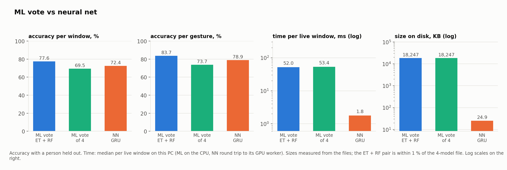

"New person" means every fold holds out one wearer completely: trained on
four people, scored on the fifth, who has calibrated. That is the honest
number for someone the model has never seen. The "same person" row is the
optimistic contrast; it is close to what you see live on yourself.

---

## How these were measured

- **Same protocol for both kinds of model.** Both trainers use the same
  window-level dedup, the same folds by person and the same `affine`
  per-wearer calibration. They also run the same DC-only control.
  `training/train_nn.py` imports these from `training/train_model.py` rather
  than re-implementing them (CLAUDE.md §8L).
- **Calibration for training is derived from each person's own recordings**
  (labels unused). That gives everyone one measurement method
  (CLAUDE.md §8n).
- **Where each number comes from:**
  - Accuracy: the cross-validation of `nn_ml_comb_test.py`, run
    `models/comb_test/20261022-003918`. Every ML model's out-of-fold
    probabilities were stored there, so every soft vote is scored on exactly
    the same windows.
  - The 4-model row: the retrain of 12:13 that day (job
    `20261022-121311_ml_f2c30d`).
  - Speed: `tools/bench_models.py`, 300 real windows from Dano's recordings,
    after warm-up. Raw output: `models/reports/bench_models_20261022.json`.
  - Size: read off the fitted objects (`estimator_size()` in
    `emg_app/model_spec.py`). The same numbers appear in **NN STATS →
    AGAINST THE DEPLOYED MODEL**.

**Two ways to average.** "Per window" is the mean of the five per-person
scores, which is what the trainers report. Pooling every window instead
gives a little more, 79.1 % for the ET + RF vote, because the hard person
(Barbora) has fewer windows. The tables quote the per-person mean unless
they say otherwise.

**Optimistic vs nested.** The 77.6 % was picked as the best of 592 model ×
setup combinations on these same five folds, so it flatters itself a
little. The **nested** check redoes the whole choice, setup and members,
without each person and then scores that person. It gives **74.0 %**,
which is the number to quote for "what would this search give a new
person".

---

## Accuracy

### Every single ML model, on the winning setup

The setup is `bandpass` signal, `level` features, 1.0 s windows at 0.75
overlap. These are single models, no voting, person held out:

| model | per window | per gesture | macro F1 |
|---|---|---|---|
| **ExtraTrees-500** | **77.4 %** | 83.3 % | 74.3 % |
| RandomForest-500 (min leaf 3) | 76.6 % | 82.3 % | 74.1 % |
| RandomForest-500 | 76.6 % | 83.3 % | 74.0 % |
| ExtraTrees-500 (min leaf 3) | 75.6 % | 80.4 % | 73.0 % |
| HistGradientBoosting (lr 0.05) | 67.8 % | 71.3 % | 64.9 % |
| MLP 128 | 67.3 % | 69.4 % | 63.4 % |
| kNN-31 | 66.5 % | 70.8 % | 62.6 % |
| kNN-15 | 66.3 % | 72.2 % | 62.3 % |
| SVM-rbf C=1 | 65.2 % | 70.8 % | 63.5 % |
| MLP 256-128 | 65.0 % | 68.9 % | 60.8 % |
| SVM-rbf C=3 | 64.9 % | 68.9 % | 61.9 % |
| SVM-rbf C=10 | 64.2 % | 67.5 % | 60.4 % |
| SVM-rbf C=30 | 64.1 % | 67.5 % | 60.3 % |
| LDA (shrinkage) | 63.1 % | 68.9 % | 61.0 % |
| LogReg C=1 | 62.6 % | 65.6 % | 60.8 % |
| LogReg C=0.1 | 61.5 % | 65.1 % | 58.4 % |

**The forests win by about 10 points, and the same is true on every other
setup searched.** The whole top 15 of 592 combinations is ExtraTrees or
RandomForest. Longer windows help the ML models: 1.0–1.3 s beat 0.5–0.7 s
everywhere. `level` features (per-channel amplitude) beat the classic shape
features on every top setup.

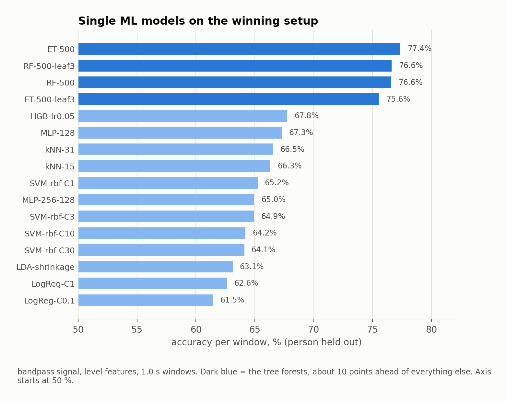

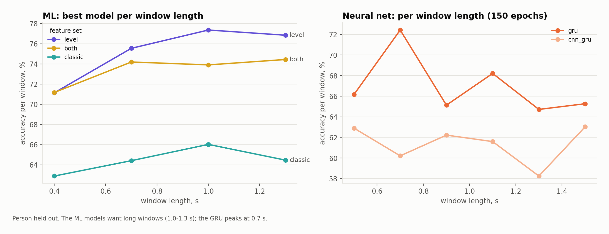

The ML curve is smooth and flattens at 1.0 s. The net's is not (65–72 %
with a single peak at 0.7 s), see *The neural net on its own* below.

### Soft voting: what it adds, and what it costs

A soft vote averages the members' predicted probabilities, and the highest
average wins. Scored on the same stored out-of-fold windows (pooled):

| vote | pooled accuracy |
|---|---|
| ExtraTrees-500 alone | 79.1 % |
| **ExtraTrees-500 + RandomForest-500 (leaf 3)** | **79.1 %** |
| ET + RF + LDA | 69.1 % |
| ET + RF + SVM-rbf C=1 + LDA | 70.5 % |
| ET + RF + SVM-rbf C=10 + LDA *(≈ the spec in use)* | 71.5 % |

1. **Voting two forests adds almost nothing.** It's +0.2 points per window
   on the per-person mean and 0.0 pooled. The two forests make nearly the
   same mistakes, so averaging them changes few answers. The search kept
   the pair because it was marginally ahead and more stable across people.
2. **Adding weaker models makes it worse, by about 8 points.** An
   unweighted average gives SVM and LDA the same say as the forests. They
   are 13–14 points worse on their own, and they are confidently wrong on
   different windows, so they outvote the forests where the forests were
   right. A soft vote only helps when its members are similarly good and
   wrong in different places.
3. **Recommendation:** use the ET + RF pair, or ExtraTrees alone (same
   accuracy, half the time per window, about three quarters of the size). To go back to the pair, untick SVM and LDA
   in **MODEL SPEC** and press RETRAIN ON ALL DATA.

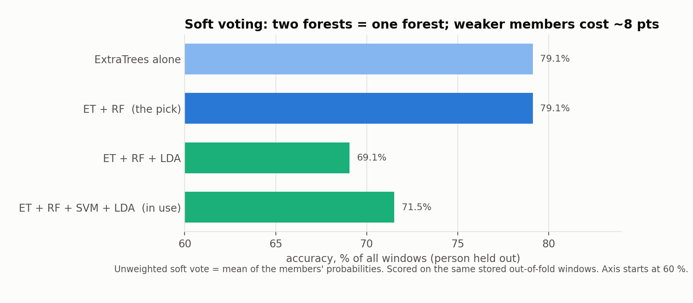

*Why* the forests add nothing to each other is in *Behaviour in detail*
(they make the same mistakes).

### Per person (each held out in turn)

| held out | ML vote ET + RF | ML vote of 4 | NN GRU |
|---|---|---|---|
| Barbora | 45.9 % | 31.0 % | 28.4 % |
| Betka | 82.8 % | 76.9 % | **92.2 %** |
| Bruno | 80.0 % | **82.6 %** | 69.8 % |
| Dano | **89.2 %** | 82.5 % | 73.9 % |
| Miso | **90.1 %** | 74.6 % | 74.6 % |

**Barbora is the hard case for every model.** Her gestures have a
different per-channel pattern, which is what a band sitting rotated on the
arm looks like (CLAUDE.md §8, §8h). No model or setting fixes that.

What would help:

- **More wearers.** Each new person makes a stranger less strange.
- **Rotation augmentation.** Train on copies with the 8 channels shifted
  round the ring by one pod. Not built yet.

The NN beats the ML vote on Betka by 9 points and loses on Dano, Miso,
Bruno and Barbora. The two models fail differently, which is why NN STATS
shows where they disagree.

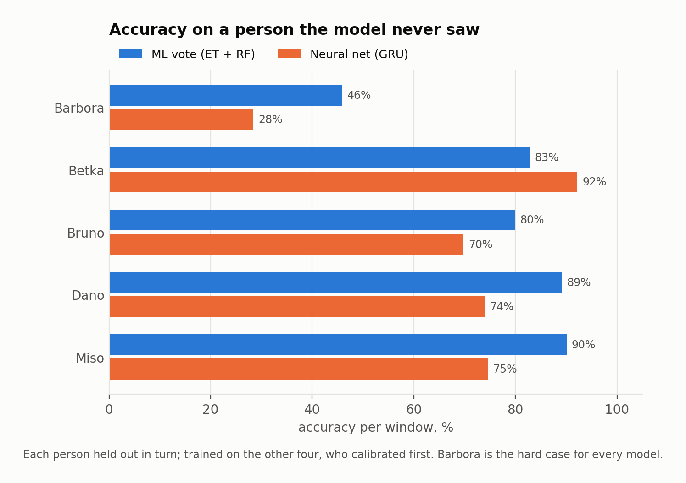

What each person's errors look like, as a confusion matrix per person, is
in *Behaviour in detail*.

### Per gesture (rows = what was made, % correct)

| gesture | ML vote ET + RF | NN GRU | main confusion |
|---|---|---|---|
| FIST | 68.3 % | 48.7 % | → OPEN |
| OPEN | 59.7 % | 60.5 % | → FIST, WAVE_RIGHT, THUMB_UP |
| REST | 93.0 % | 92.5 % | → THUMB_UP |
| THUMB_UP | 59.2 % | 54.2 % | → OPEN |
| WAVE_LEFT | 98.4 % | 93.3 % | — |
| WAVE_RIGHT | 91.6 % | 85.2 % | → OPEN |

The waves and REST are easy for both. **FIST, OPEN and THUMB_UP are where
both models lose their points**, and that is what pulls macro F1 below the
accuracy. The three gestures use overlapping forearm muscles, and on an
8-pod band their patterns sit close together (CLAUDE.md §7a measured OPEN
against WAVE_RIGHT at 0.978 cosine).

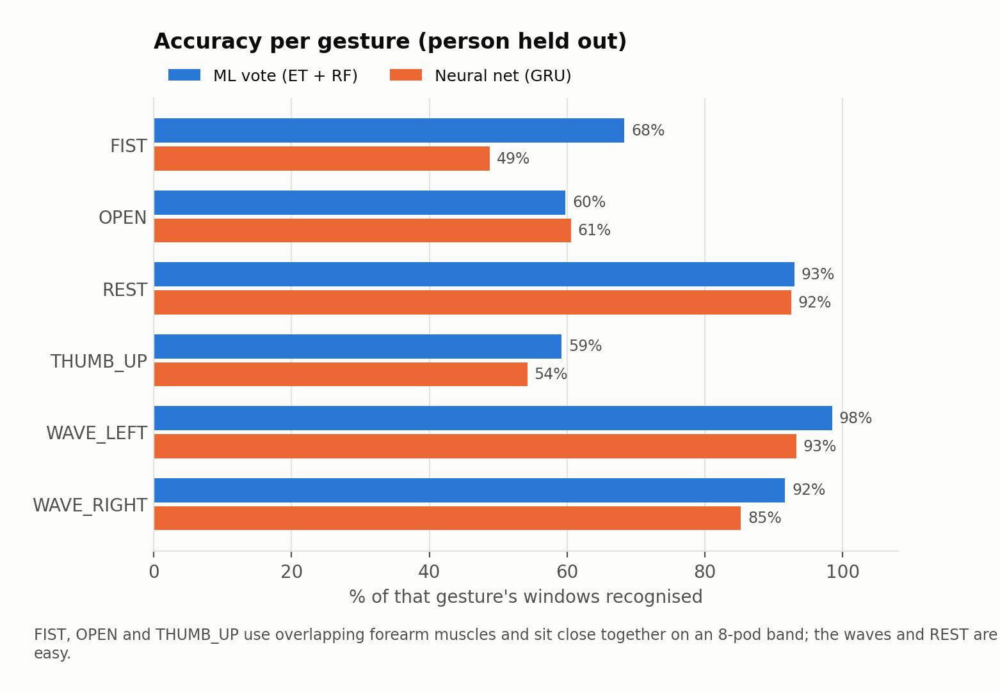

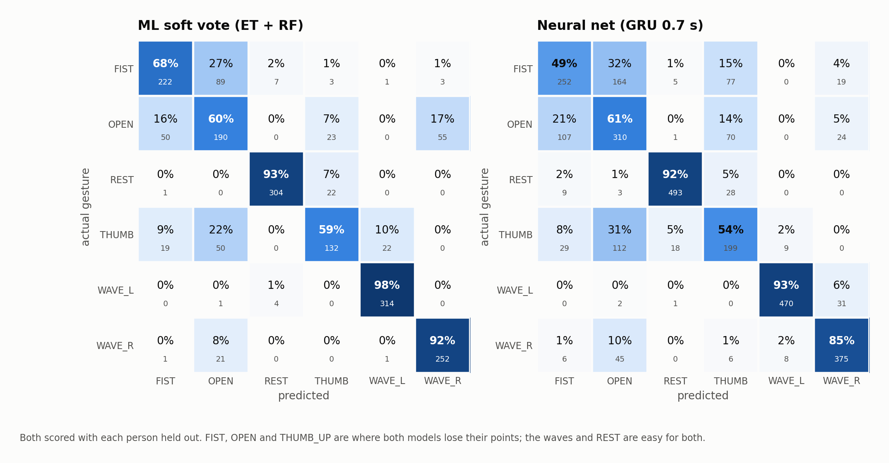

Rows are what was made, columns what the model said; the big number is the
% of that row, the small one the window count. Precision, recall and where
the two models differ cell by cell are in *Behaviour in detail*.

### What each model is actually reading: the DC-only control

The control asks how well the same model does when each window is replaced
by just its 8 channel averages, with no shape and no timing:

| | full input | DC-only control | what the extra input is worth |
|---|---|---|---|
| ML vote ET + RF (`level` features) | 77.6 % | 77.8 % | **≈ 0** |
| ML vote of 4 | 69.5 % | 74.6 % | negative |
| NN GRU | 72.4 % | 63.3 % | **+9.2 points** |

- **The ML model reads the calibrated activation level of each channel,
  and only that.** Its 50 `level` features add nothing over the 8 averages.
  That is not a bug: after per-wearer calibration, those averages are a
  good and transferable description of a held gesture. But it also means
  the ML model cannot tell two gestures apart that differ only in how they
  move.
- **The NN genuinely uses the time course of the signal**, which is worth
  +9.2 points to it. That is the one reason to expect it to keep improving
  as data grows, where the ML vote is close to what amplitude levels can
  give (CLAUDE.md §8L).

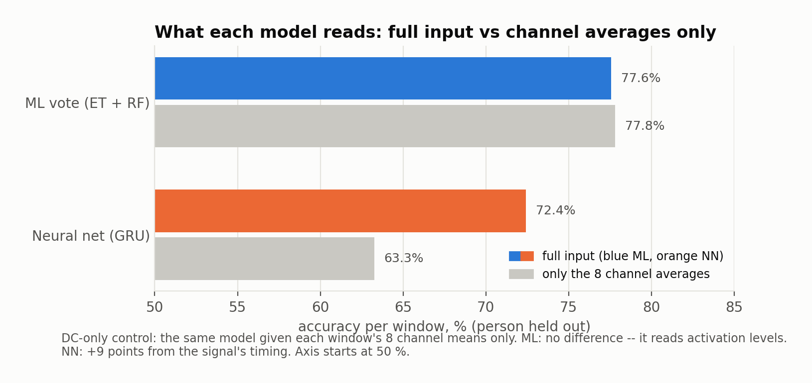

---

## Behaviour in detail

The tables above say how often each model is right. This section says
**how it fails**: where, for whom, how sure it is when it does, and what
the answer looks like over a recording. Everything here is read from the
saved comb-test results (nothing was retrained), with the person held out.

> **What could and could not be drawn.** The comb test stored the ML
> models' probability for every held-out window, but for the net only the
> *summed* confusion matrix, its fold and per-person scores, and the
> DC-only control. So anything that needs a probability per window (a
> confusion matrix per person, confidence, calibration, timelines,
> window-by-window agreement with the ML vote) is **ML only**, and each
> figure says so. The net's side is complete for everything that follows
> from the matrices. Getting the rest means re-running the net's
> cross-validation while keeping its probabilities (about 10 minutes on
> the GPU); it was not done.

### Who fails, and how

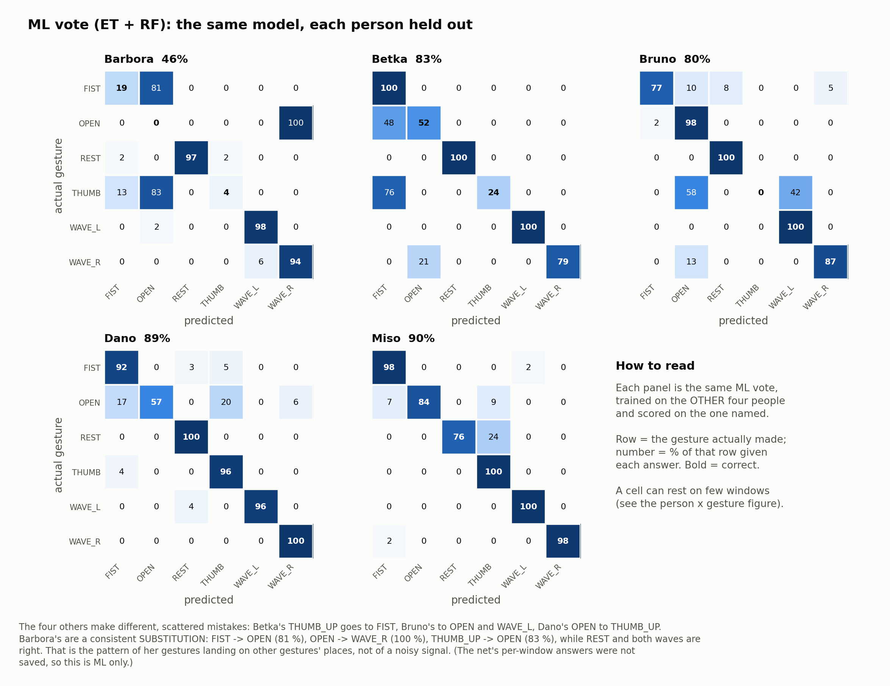

- **Four of five people are well served** (80–90 % per window) and make
  *different, scattered* mistakes: Betka's THUMB_UP becomes FIST, Bruno's
  becomes OPEN or WAVE_L, Dano's OPEN becomes THUMB_UP. There is no one pair
  of gestures every wearer confuses.
- **Barbora's failure has another shape.** Her gestures are not blurred,
  they are *substituted*: FIST → OPEN (81 %), OPEN → WAVE_R (100 %),
  THUMB_UP → OPEN (83 %), each one answered with a single wrong gesture,
  while REST and both waves are right (94–98 %). That is the pattern of a
  person whose forearm pattern for a gesture lands where another wearer's
  pattern for a different gesture sits, which is what a rotated band would
  do (CLAUDE.md §8h). It is a hypothesis consistent with the picture, not
  something tested here.

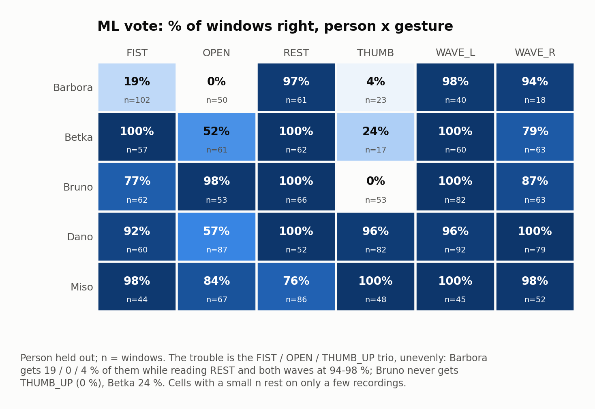

The same information as one table. **The trouble is the FIST / OPEN /
THUMB_UP trio, and it is uneven**: Barbora gets 19 / 0 / 4 % of them,
Bruno never gets THUMB_UP (0 %), Betka 24 %, while Dano and Miso are at 76–100 %
everywhere except Dano's OPEN (57 %). Cells such as Betka's THUMB_UP (17 windows)
come from only a few recordings, so read the large differences, not the
small ones.

### The two models, gesture by gesture

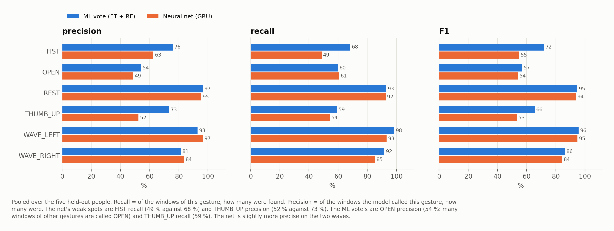

| | the ML vote is weakest at | the net is weakest at |
|---|---|---|
| recall (gesture found) | THUMB_UP 59 %, OPEN 60 % | **FIST 49 %**, THUMB_UP 54 % |
| precision (answer trusted) | **OPEN 54 %** | OPEN 49 %, **THUMB_UP 52 %** |

Both are near 90–98 % on REST and the waves. The net is slightly more
precise than the vote on both waves (97 against 93 on WAVE_LEFT, 84
against 81 on WAVE_RIGHT); the vote is ahead on nearly everything else
(OPEN recall is a tie, 60 against 61).

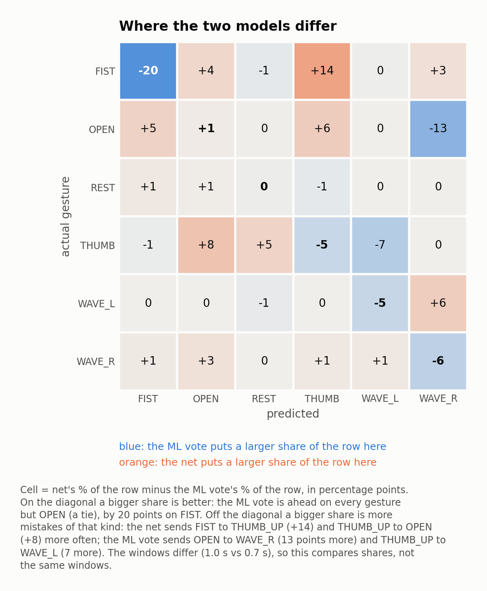

The two models also make **different** mistakes, not just more or fewer.
The net sends FIST to THUMB_UP (+14 points) and THUMB_UP to OPEN (+8) more
often. The vote sends OPEN to WAVE_R (13 points more) and THUMB_UP to
WAVE_L (7 more). On the diagonal the vote is ahead on every gesture except
OPEN, where they tie: by 20 points on FIST, 5–6 on THUMB_UP and the waves,
none on REST. (The windows
differ, 1.0 s against 0.7 s, so this compares shares of a row, not the
same windows.)

### How sure the ML vote is, and whether to believe it

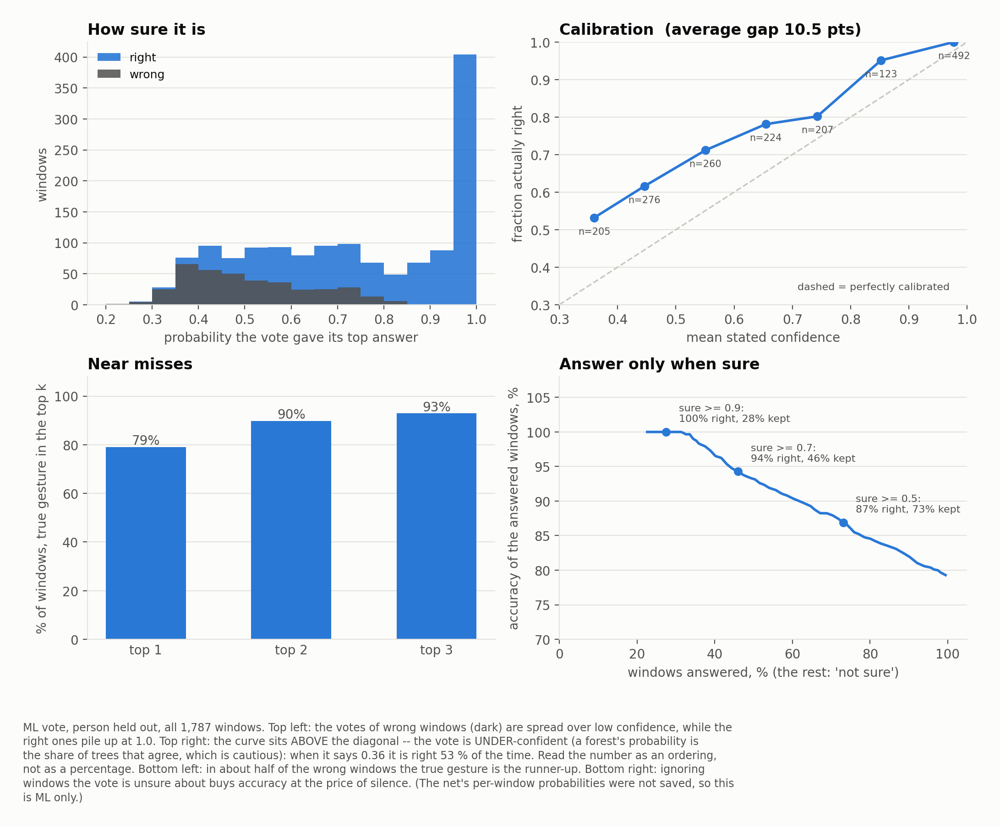

- **Wrong answers are less sure than right ones**: mean top probability
  0.51 against 0.73. 28 % of the windows score 0.9 or above, and those are
  right every time.
- **The number is under-confident, not over-confident.** A forest's
  probability is the share of its trees that agree, which is cautious: at
  0.36 it is right 53 % of the time, at 0.65 it is right 78 %. Read it as
  an *ordering* of how much to trust an answer, not as a percentage.
- **It makes a usable "not sure" signal.** Answering only when the top
  probability is at least 0.7 keeps 46 % of the windows at 94 % accuracy;
  at 0.9, 28 % of them at 100 %; at 0.5, 73 % at 87 %. Across everything:
  79 %.
- **It does not help for a person the model cannot read.** For Barbora
  the mean confidence is the same when she is right (0.60) as when she is
  wrong (0.61): the model is as sure of its substituted answer as of a good
  one. The other four read 0.38–0.53 when wrong against 0.64–0.82 when
  right, so the signal works for them.
- **Near misses are common.** The right gesture is the runner-up in about
  half of the wrong windows: 79 % top-1, 90 % top-2, 93 % top-3.

### Why soft voting adds so little

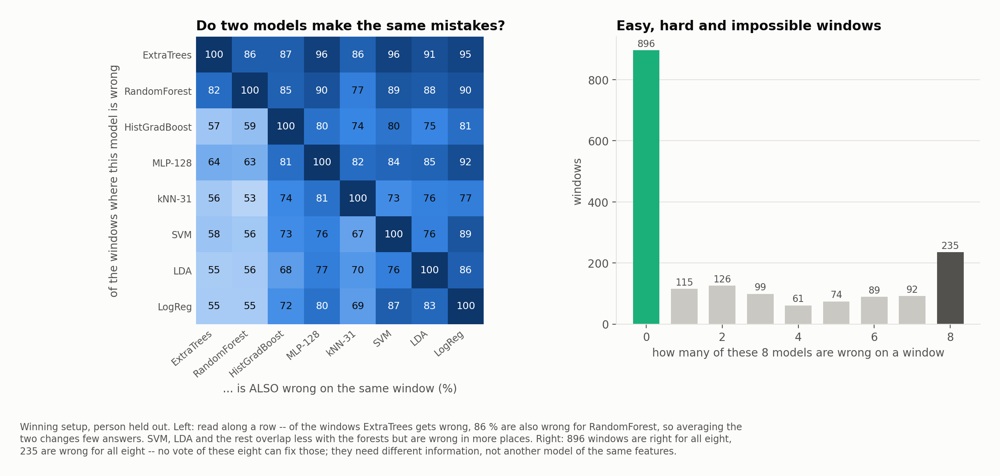

Read a row: **of the windows ExtraTrees gets wrong, 86 % are also wrong
for RandomForest.** Two forests built on the same 50 features make nearly
the same mistakes, so averaging them changes few answers (the +0.2 in
*Soft voting*). The weaker models (SVM, LDA, LogReg) overlap less with the
forests, but only because they are wrong in more places, which is how an
unweighted vote ends up worse than its best member.

The right-hand chart is the ceiling for any vote of these eight models:
**896 windows (50 %) are right for all eight and 235 (13 %) are wrong for
all eight.** Those 13 % are not a choice-of-model problem. They need other
information (another sitting of the person, another band position), not
another classifier on the same features.

### What the answer looks like over a recording

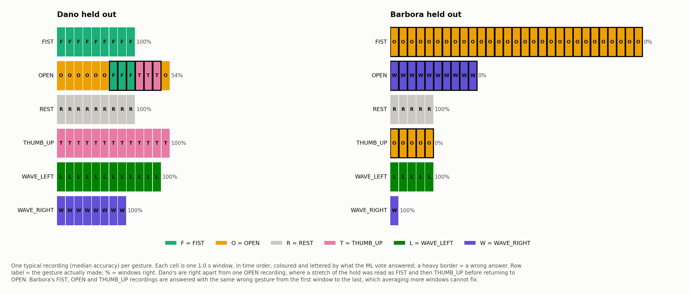

One recording of each gesture (the median-accuracy one, not the best), each
cell one window in time order. For a well-served person (Dano) every
recording is answered correctly throughout, except one OPEN recording where
a stretch of the hold was read as FIST and then THUMB_UP before returning
to OPEN. For Barbora, her FIST, OPEN and THUMB_UP recordings are answered
with **the same wrong gesture from the first window to the last**. That is
a systematic error, not noise, and the next figure shows what it means for
smoothing.

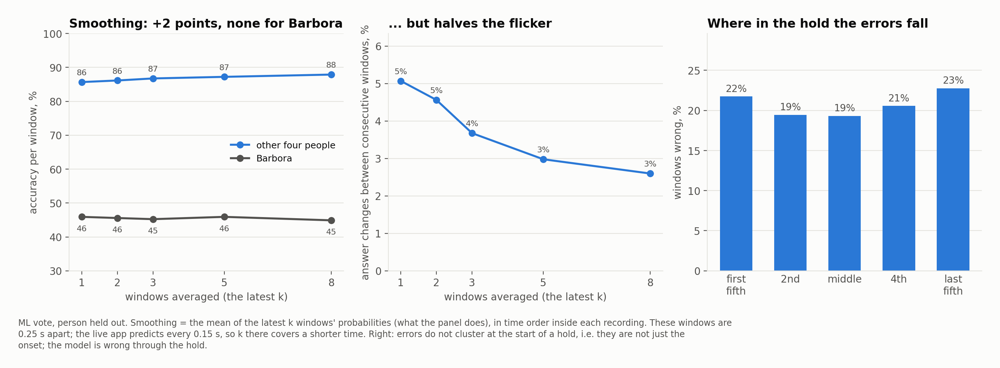

- **Smoothing is cheap but small.** Averaging the latest *k* windows'
  probabilities (what the LIVE CLASSIFIER panel does) lifts the four
  well-served people from 86 % to 88 % at *k* = 8, and does nothing for
  Barbora (46 % → 45 %): a model that is consistently wrong stays
  consistently wrong however many windows it averages.
- **It does halve the flicker**: the answer changes between consecutive
  windows 5.1 % of the time unsmoothed, 2.6 % at *k* = 8. That is the
  visible benefit.
- **Errors are not an onset effect.** The share of wrong windows is 22 / 19
  / 19 / 21 / 23 % across the five fifths of a hold. The model is not
  just late to react; it is wrong, or right, for the whole hold.
- *Caveat:* these windows are 0.25 s apart; the app predicts every 0.15 s,
  so *k* windows live cover a shorter time than here.

### The price of a new person

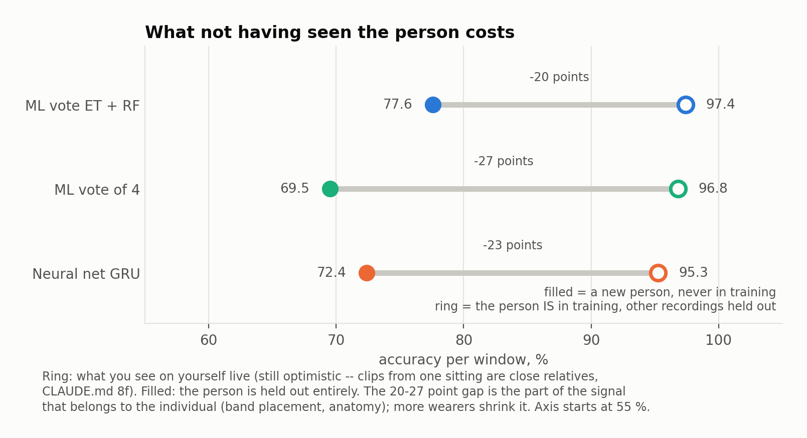

Scored on a person who is **in** the training data (other recordings held
out), all three models read **95–97 %**; on a person who is not, 70–78 %.
The gap is 20 points for the ET + RF vote, 27 for the vote of four and 23
for the net, and it is the part of the signal that belongs to the
individual: band placement, anatomy, how they make a fist. Two things
follow. The gap is where more wearers pay off, and the 95–97 % is an
optimistic figure even for the person themselves, because clips from one
sitting are close relatives (CLAUDE.md §8f).

### The neural net on its own

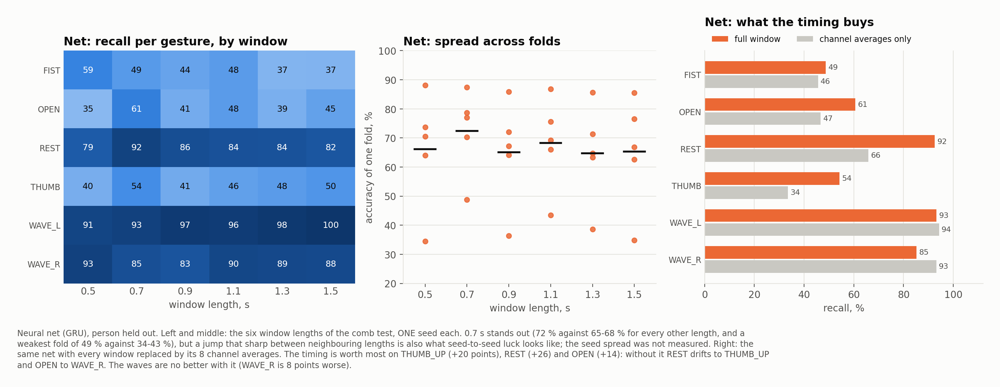

- **Window length.** The GRU peaks at 0.7 s (72 %), with every other
  length at 65–68 %. 0.7 s also has the narrowest spread between folds
  (weakest fold 49 %, against 34–43 % elsewhere). **A jump that sharp
  between neighbouring lengths is also what seed luck looks like**, and
  every length was run with one seed, so how much of the 0.7 s advantage is
  real is not known. The ML vote's window curve is smooth by comparison
  (above).
- **What each gesture gets from the timing.** With each window replaced by
  its eight channel averages the net loses **26 points on REST, 20 on
  THUMB_UP and 14 on OPEN** (REST drifts to THUMB_UP, OPEN to WAVE_R), and
  3 on FIST. It gains nothing on the waves (WAVE_R is 8 points *better*
  without timing). So the +9.2 points in the DC-only table come from three
  gestures; two of them, OPEN and THUMB_UP, are also the ML vote's hardest.
- **It is not steady across people.** Its per-person scores run from 28 %
  (Barbora) to 92 % (Betka), a 64-point spread, against the vote's 44
  (46 % to 90 %): it is better than the vote on one person (Betka) and
  worse on the other four.

### Why these gestures collide

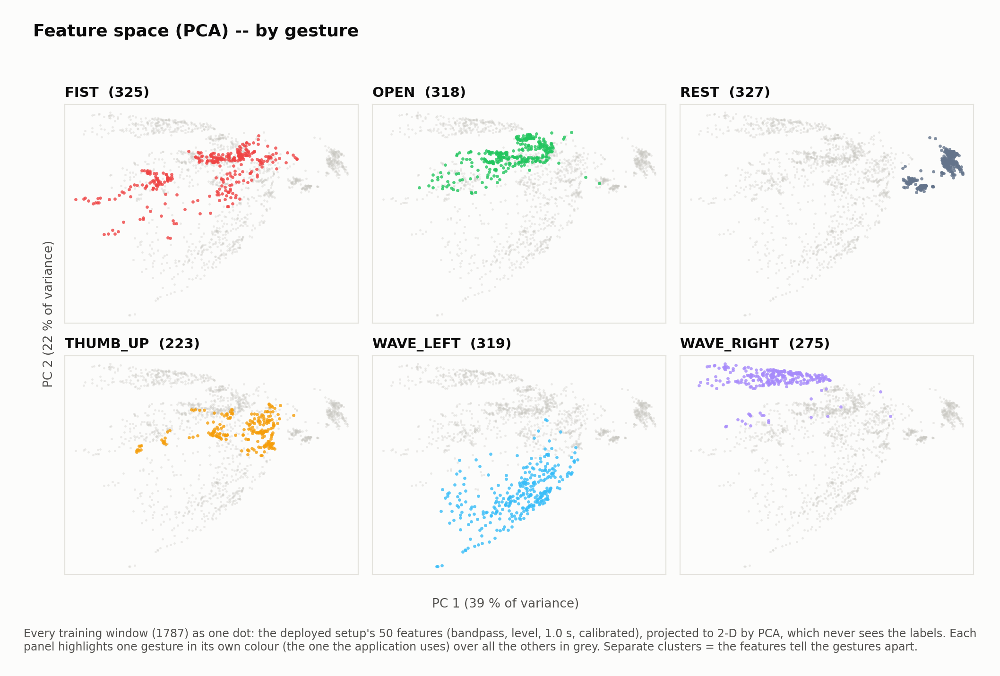

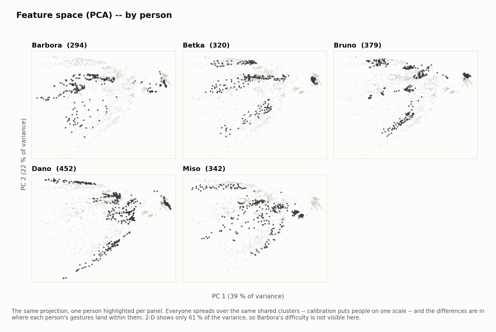

Every training window projected to two dimensions by a method that never
sees the labels, at the deployed setup. The waves and REST form their own
islands; FIST, OPEN and THUMB_UP overlap in the middle. That is the same
trio the confusion matrices lose their points on, and it is why no choice
of model removes the errors above: the three are close in these features.
Two dimensions show only 61 % of the variance, so what is *not* visible,
Barbora's pattern, is not evidence that it is absent.

---

## Speed

Per live window on this machine, median over 300 real windows (95th
percentile in brackets). The app predicts every **150 ms**
(`PREDICTION_INTERVAL_MS`), so everything below that keeps up.

| step | time |
|---|---|
| ML: resample + calibrate + 50 features | 1.7 ms |
| ML: ExtraTrees-500 | 25.3 ms (29.9) |
| ML: RandomForest-500 (leaf 3) | 25.0 ms (28.0) |
| ML: SVM-rbf | 0.26 ms |
| ML: LDA | 0.23 ms |
| **ML: whole vote of 4, as the LIVE CLASSIFIER runs it** | **53.4 ms (60.0)** |
| ML: whole vote ET + RF (sum of the parts) | ~52 ms |
| **NN: round trip to the GPU worker** (send, forward pass, answer) | **1.8 ms (2.8)**, of which 0.9 ms is the forward pass |
| NN: same worker on the CPU | 2.9 ms (4.0), of which 1.9 ms is the forward pass |

- **The NN is about 30× faster per window, even on the CPU.** It
  multiplies 4,455 weights; each forest walks 500 trees per answer.
- **The ML vote's time is almost all the two forests.** SVM and LDA cost
  under a millisecond; they cost accuracy, not time.

> **Fixed while measuring this.** The forests were saved with `n_jobs=-1`
> (use every core), which is right for training and wrong for one live row:
> every prediction started a pool of worker processes. The live vote took
> **148 ms per window, right at the 150 ms interval**, so the classifier
> could miss windows. `LivePredictor` now sets the model to one thread on
> load (`serialise_estimator()` in `emg_app/model_spec.py`, the same thing
> the DECISION TRAIL panel already did). That gives **53 ms, with
> identical answers**: `n_jobs` changes how a forest is evaluated, never
> what it says.

**Signal needed.** The ML model needs a 1.0 s window and the NN 0.7 s, so
after a change of gesture the NN can settle about 0.3 s sooner. Both then
smooth over their last few answers in the panel.

---

## Size

| | on disk | learned numbers | made of |
|---|---|---|---|
| ExtraTrees-500 | — | 945,926 | 500 trees, 118,240 nodes |
| RandomForest-500 (leaf 3) | — | 346,294 | 500 trees, 43,286 nodes |
| SVM-rbf | — | 17,531 | 284 support vectors × 50 |
| LDA | — | 3,268 | weights 6 × 50 (+ its covariance) |
| **ML vote of 4** | **17.8 MB** | **1,313,019** | all four |
| ML vote ET + RF | ~17.7 MB | 1,292,220 | the two forests |
| **NN GRU** | **25 KB** | **4,455** | GRU (hidden 32) + attention pooling |

"Learned numbers" counts what each model stores to make a prediction. For a
tree node that is its split (feature and threshold) and its class values;
for the net, its weights. The comparison is fair as a size, but a tree node
is a look-up and a weight is a multiply.

**What this means for the robot.**

- **The ML vote** is large (18 MB) but needs only scikit-learn on a CPU.
  It costs ~50 ms per window: fine on a PC, worth measuring again on a
  small board.
- **The NN** is tiny (25 KB) and fast, but needs **torch**, which is a
  ~200 MB install. That was the original reason the NN was kept out of
  deployment (CLAUDE.md §8b). Exporting it to ONNX would remove that need.
  Not done.

---

## Training time

| | time | on |
|---|---|---|
| RETRAIN ON ALL DATA (pinned spec: 1 setup, cross-validated, final fit, panel) | ~1.6 min | CPU |
| TRAIN NEURAL NET (GRU 0.7 s, 150 epochs, cross-validated + DC-only control + final fit) | ~10–12.5 min | GPU |
| RETRAIN ML + NEURAL NET (both, one after the other) | ~12–14 min | both |
| the search that chose all this (`nn_ml_comb_test.py`) | ~10.5 h | both |

---

## Which to use

- **For the app's answer:** the ML vote of **ExtraTrees + RandomForest**,
  or ExtraTrees alone. It's the most accurate on a new person (77.6 % per
  window, 83.7 % per gesture) and needs no torch. Switch the spec in use
  back to it (MODEL SPEC → untick SVM and LDA → RETRAIN).
- **As a second opinion:** the NN (START NN). It's right 72 % of the time
  per window, reads the timing the ML model ignores, and disagrees in
  useful places (Betka). The two are never averaged (safety rule 13).
- **For yourself, in practice:** run **TEST MODEL**. You are in the
  training data, so both models will do much better on you than the
  new-person numbers above (95–97 % on held-out recordings of the same
  person).

**Caveats.**

- **Five people** is a small sample. The ± on these numbers is the
  person-to-person spread, ±13 to ±20 points, and one person (Barbora)
  dominates it.
- **The NN figure is one training seed.** Its seed-to-seed spread was not
  measured; the search was stopped after the window-length stage, by choice.
  The net's sharp peak at 0.7 s is the place this matters most.
- **The net's per-window probabilities were not saved**, so *Behaviour in
  detail* shows the ML vote's confusion per person, confidence, calibration
  and timelines but has no counterpart for the net. Its summed confusion
  matrix, per-person and per-fold scores, window-length sweep and DC-only
  control are all there.
- **Per-person cells are small.** Each person has 17–102 windows of a
  gesture, from a handful of recordings, so a single cell (Betka's
  THUMB_UP, for one) can move a lot with one more recording.
- **The ML vote's confidence and the smoothing numbers are for the winning
  setup** (1.0 s windows, 0.25 s apart); the live app predicts every
  0.15 s.

---

## Figures

Generated from the saved results, nothing retrained, so they can be
regenerated after any retrain:

```powershell
python tools/make_figures.py              # the first set (needs the dataset, for the PCA)
python tools/make_figures_behaviour.py    # the behaviour set (saved results only, seconds)
```

Written to `docs/figures/`. Each is shown where it is discussed above;
this is the index.

| Figure | Shows |
|---|---|
| `ml_vs_nn.png` | the two models side by side: accuracy, time per window, size |
| `confusion_both.png` | both confusion matrices, person held out |
| `confusion_ml_vote.png`, `confusion_nn.png` | the same, one model each |
| `accuracy_per_person.png` | each person held out in turn |
| `accuracy_per_gesture.png` | % recognised per gesture |
| `ml_single_models.png` | every ML model on the winning setup |
| `soft_voting.png` | what soft voting adds and costs |
| `window_length.png` | accuracy against window length, ML and NN |
| `dc_only_control.png` | full input vs channel averages only |
| `pca_by_gesture.png`, `pca_by_person.png` | the feature space (PCA) |
| `confusion_per_person_ml.png` | the ML vote's confusion matrix for each person held out |
| `person_gesture_heatmap.png` | % right per person × gesture |
| `precision_recall_f1.png` | precision, recall and F1 per gesture, both models |
| `confusion_difference.png` | the net's confusion minus the vote's, cell by cell |
| `ml_confidence.png` | confidence, calibration, near misses, answer-only-when-sure |
| `ml_error_overlap.png` | do the ML models make the same mistakes |
| `ml_timeline.png` | one recording per gesture as a strip of window answers |
| `ml_live_behaviour.png` | smoothing, flicker, where in a hold errors fall |
| `generalisation_gap.png` | same person vs a person never seen |
| `nn_behaviour.png` | the net: per-gesture recall by window, fold spread, what timing buys |

---

## Reproduce

```powershell
python training/nn_ml_comb_test.py --resume models/comb_test/20261022-003918 --no-apply   # the search (done runs are skipped)
python tools/comb_test_report.py models/comb_test/20261022-003918                        # spreadsheet + docs/COMB_TEST.md
python tools/bench_models.py --windows 300 --json models/reports/bench_models.json      # speed
python training/train_model.py --spec models/model_spec.json --calibration affine       # the ML numbers for a spec
python training/train_nn.py --kind gru --window 0.7 --epochs 150 --calibration affine   # the NN numbers
python tools/make_figures.py                                                            # figures, first set
python tools/make_figures_behaviour.py                                                  # figures, behaviour set
```

Full search tables: [`COMB_TEST.md`](COMB_TEST.md) and
`models/comb_test/20261022-003918/comb_test_results.xlsx`.
