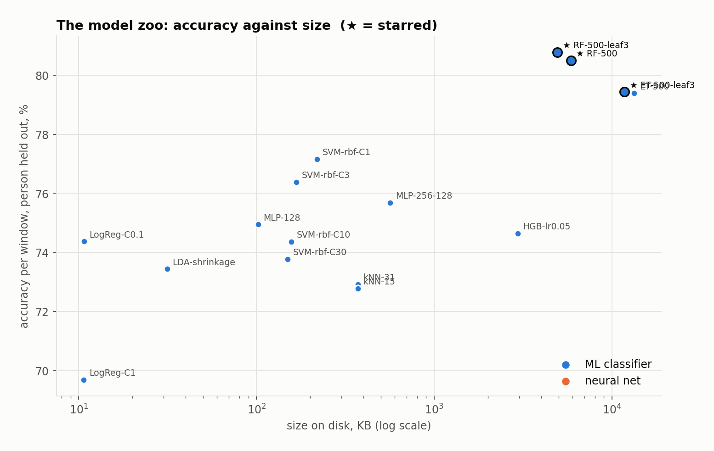
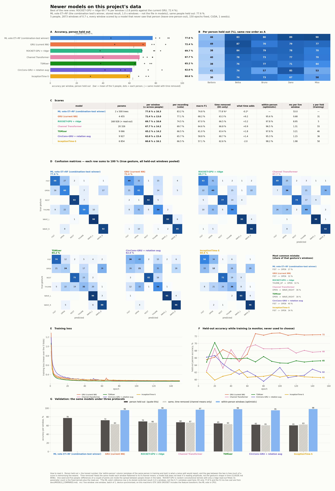
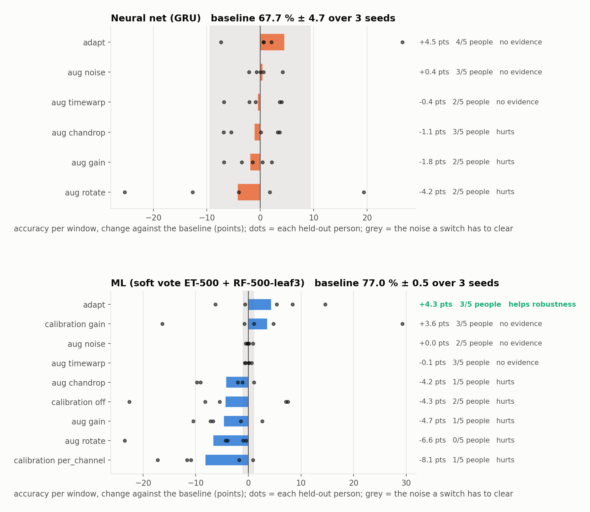
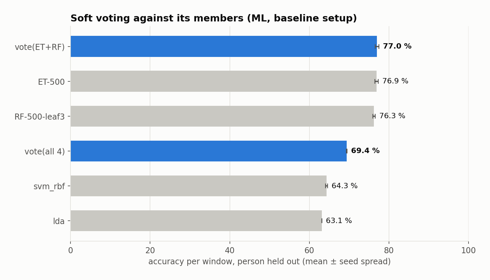
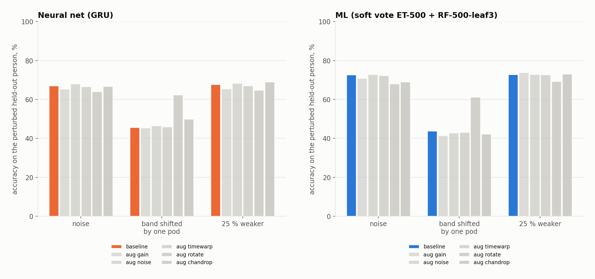
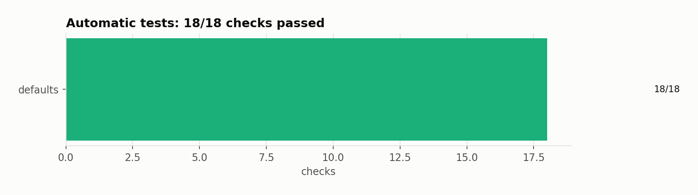

# Report: models, ablation, defaults and verification

*Generated 2026-10-27 03:38 by `tools/make_report.py` from `results/experiments.json`. Re-run it after any new measurement; nothing below is typed by hand.*

## 1. Goal and context

The project records 8-channel EMG from a Thalmic Myo and trains gesture classifiers that must work on a person they have never seen. This pass added: a **model zoo** (every classifier trained, measured and selectable), **soft voting** of selected models, **augmentation** and **adaptation to the person**, two questions the application asks (calibrate the hand; retrain), a settings area for all of it, an application icon, and the documentation and checks needed before the first test on a new band (`docs/sdk_myo.md`, `docs/install_windows.md`, `docs/install_linux.md`). Every new feature is off, or equal to the old behaviour, unless a measurement below says otherwise (`docs/FEATURES.md` lists how to turn each on and off).

## 2. Data

5 people (Barbora, Betka, Bruno, Dano, Miso), 211 recordings, six gestures (REST, FIST, OPEN, THUMB_UP, WAVE_LEFT, WAVE_RIGHT), per-wearer calibration `affine`, derived from each person's own recordings. After window-level deduplication the NN windows (0.7 s at 0.75 overlap) number 2873. **Five people is small**: a difference of a couple of points is inside the spread between people, and the weakest person (Barbora, a differently seated band) alone moves every average by about 10 points. `docs/EDA.md` and `docs/MODELS_COMPARED.md` describe the data in full.

## 3. Methods

- **Protocol.** Leave-one-person-out: every window is scored by a model that never saw that person. The score is the mean over the five held-out people (each counts once). Per-recording vote and macro-F1 are reported beside it.
- **Seeds.** Ablations use 3 seeds and report mean ± seed spread; the zoo uses 2 seeds for the nets and 3 for the ML models.
- **A switch counts as helping** (`training/ablation_stats.py`) only if its mean gain over the baseline is at least max(1 point, 2 x the seed noise) AND it is better for at least 4 of the 5 people; or the same on the robustness probes without losing more than 1 point of clean accuracy. Anything else is "no evidence", stays off and remains selectable.
- **Robustness probes**, applied to the held-out person's raw windows after the fact: multiplicative + additive noise; the band slid one pod either way (a circular channel roll); the whole signal 25 % weaker. Statistics for adaptation are taken before the perturbation (a band that drifts after calibration).
- **DC-only control** (CLAUDE.md 8f/8k): the same model on each window flattened to its 8 channel means -- how much of a score is amplitude rather than gesture shape.
- **Adaptation** standardises each person's input with statistics from a random 10 % of their own unlabelled windows (about 9 s, a calibration sweep). It is *not* zero-shot: it answers "a new person who wears the band for a few seconds first".

## 4. Models and sizes

16 ML classifiers and 0 neural nets are in the zoo, all trained on the whole dataset and scored leave-one-person-out. ★ = starred (top 3 per family by accuracy per window, ties by macro-F1).

<!-- TABLE: models_ml -->

|  | model | per window | macro-F1 | per recording | size on disk | ms / live window | trained with |
|---|---|---|---|---|---|---|---|
| ★ | RF-500-leaf3 | 80.8 % | 78.6 % | 86.3 % | 4.8 MB | 26.3 | adaptation |
| ★ | RF-500 | 80.5 % | 78.0 % | 85.5 % | 5.7 MB | 24.9 | adaptation |
| ★ | ET-500-leaf3 | 79.4 % | 77.9 % | 84.7 % | 11.5 MB | 25.4 | adaptation |
|  | ET-500 | 79.4 % | 77.7 % | 85.1 % | 13.0 MB | 26.3 | adaptation |
|  | SVM-rbf-C1 | 77.2 % | 75.4 % | 81.7 % | 218.9 KB | 0.28 | adaptation |
|  | SVM-rbf-C3 | 76.4 % | 74.1 % | 81.6 % | 167.4 KB | 0.27 | adaptation |
|  | MLP-256-128 | 75.7 % | 73.1 % | 80.2 % | 564.3 KB | 0.23 | adaptation |
|  | MLP-128 | 74.9 % | 72.0 % | 79.8 % | 102.0 KB | 0.41 | adaptation |
|  | HGB-lr0.05 | 74.6 % | 70.9 % | 79.5 % | 2.9 MB | 33.7 | adaptation |
|  | LogReg-C0.1 | 74.4 % | 71.4 % | 77.4 % | 10.7 KB | 0.27 | adaptation |
|  | SVM-rbf-C10 | 74.4 % | 71.7 % | 79.3 % | 157.0 KB | 0.47 | adaptation |
|  | SVM-rbf-C30 | 73.8 % | 71.1 % | 78.4 % | 149.9 KB | 0.26 | adaptation |
|  | LDA-shrinkage | 73.4 % | 71.0 % | 77.6 % | 31.4 KB | 0.42 | adaptation |
|  | kNN-31 | 72.9 % | 70.3 % | 78.7 % | 371.2 KB | 1.41 | adaptation |
|  | kNN-15 | 72.8 % | 70.4 % | 79.3 % | 371.2 KB | 1.20 | adaptation |
|  | LogReg-C1 | 69.7 % | 66.2 % | 73.5 % | 10.7 KB | 0.40 | adaptation |

<!-- TABLE: models_nn -->

|  | model | per window | macro-F1 | per recording | parameters | size on disk | ms / live window |
|---|---|---|---|---|---|---|---|

<!-- TABLE: model_sizes -->

The whole ML zoo is 40.0 MB; the whole neural zoo 0 B. Latency was measured while other jobs shared the machine; treat the ranking, not the absolute numbers, as the finding.

**Best ML soft-voting subset:** ml-rf-500, ml-rf-500-leaf3, ml-et-500, ml-logreg-c0.1 -- 79.3 % on the folds it was searched on, **77.0 % nested** (chosen without the held-out person), against 77.6 % for the best single model. It does not beat the best single model, so it is not starred.

## 5. Newer architectures

`tools/new_models_test.py` trained five architectures newer than LSTM/GRU under the same protocol, 150 epochs, one seed, on CUDA:

<!-- TABLE: new_models_test -->

| model | parameters | person held out | time removed (DC-only) | within-person (optimistic) | ms / window |
|---|---|---|---|---|---|
| GRU (current NN) | 4 455 | 72.4 % | 63.3 % | 95.6 % | 0.68 |
| ROCKET-GPU + ridge | 168 928 | 69.7 % | 66.5 % | 97.8 % | 8.95 |
| Channel Transformer | 20 326 | 67.7 % | 66.8 % | 96.5 % | 1.31 |
| TSMixer | 9 066 | 65.2 % | 63.4 % | 97.8 % | 3.21 |
| CircConv-GRU + rotation aug | 9 927 | 62.0 % | 60.7 % | 95.3 % | 1.15 |
| InceptionTime-S | 6 854 | 60.6 % | 62.6 % | 98.2 % | 1.98 |

Result: **none of them beat the GRU** -- GRU 72.4 %, best of the new ones ROCKET-GPU + ridge 69.7 %. Every new model is far better within-person (95 - 98 %) than across people, which is the usual sign that capacity goes into memorising the wearer. With one seed, differences of a few points are within noise (the GRU alone varied by about 10 points between seeds in the ablation below).

## 6. Ablation study, and how the defaults were chosen

One switch at a time against the baseline, then only combinations of what helped (stage B).

### Neural net (GRU, 0.7 s)

<!-- TABLE: ablation_nn -->

| setting | seeds | per window | ± seeds | macro-F1 | change | people better | robustness change | verdict |
|---|---|---|---|---|---|---|---|---|
| baseline | 3 | 67.7 % | 4.7 % | 63.9 % | -- | -- | -- | reference |
| aug:gain | 3 | 65.9 % | 3.6 % | 62.2 % | -1.8 | 2/5 | -1.4 | hurts |
| aug:noise | 3 | 68.2 % | 2.4 % | 63.8 % | +0.4 | 3/5 | +0.8 | no evidence |
| aug:timewarp | 1 | 68.9 % | 0.0 % | 66.1 % | +1.2 | 3/5 | +0.4 | no evidence |

### ML (soft vote ET-500 + RF-500-leaf3)

<!-- TABLE: ablation_ml -->

| setting | seeds | per window | ± seeds | macro-F1 | change | people better | robustness change | verdict |
|---|---|---|---|---|---|---|---|---|
| baseline | 3 | 77.0 % | 0.5 % | 74.3 % | -- | -- | -- | reference |
| aug:gain | 3 | 72.4 % | 0.4 % | 70.0 % | -4.7 | 1/5 | -1.1 | hurts |
| aug:noise | 3 | 77.1 % | 0.4 % | 74.3 % | +0.0 | 2/5 | -0.3 | no evidence |
| aug:timewarp | 3 | 76.9 % | 0.3 % | 74.3 % | -0.1 | 3/5 | -0.4 | no evidence |
| aug:rotate | 3 | 70.4 % | 0.8 % | 67.3 % | -6.6 | 0/5 | +3.1 | hurts |
| aug:chandrop | 3 | 72.8 % | 1.6 % | 70.6 % | -4.2 | 1/5 | -1.6 | hurts |
| adapt | 3 | 81.3 % | 2.5 % | 79.1 % | +4.3 | 3/5 | +3.7 | helps robustness |
| calib:off | 3 | 72.7 % | 0.5 % | 67.8 % | -4.3 | 2/5 | +2.2 | hurts |
| calib:gain | 3 | 80.6 % | 0.3 % | 76.8 % | +3.6 | 3/5 | +3.3 | no evidence |
| calib:per_channel | 3 | 68.9 % | 0.3 % | 65.3 % | -8.1 | 1/5 | -3.4 | hurts |

### Voting against its members

<!-- TABLE: ablation_voting -->

| model | per window | ± seeds | macro-F1 | size | ms / window |
|---|---|---|---|---|---|
| ET-500 | 76.9 % | 0.4 % | 74.2 % | 8.9 MB | 31.7 |
| RF-500-leaf3 | 76.3 % | 0.3 % | 73.9 % | 3.3 MB | 27.5 |
| lda | 63.1 % | 0.0 % | 61.0 % | 25.7 KB | 0.28 |
| svm_rbf | 64.3 % | 0.2 % | 60.5 % | 106.9 KB | 0.26 |
| vote(ET+RF) | 77.0 % | 0.5 % | 74.3 % | 12.2 MB | 59.2 |
| vote(all 4) | 69.4 % | 0.1 % | 67.5 % | 12.3 MB | 59.7 |

The deployed pair's vote is 77.0 % against 76.9 % for the best single member (ET-500): a gain of +0.1 points, inside the seed spread -- voting does not demonstrably help here. Voting all four spec models falls to 69.4 %: an unweighted vote gives the 13-point weaker SVM and LDA an equal say.

### Defaults

<!-- TABLE: defaults -->

| family | setting | shipped value | why |
|---|---|---|---|
| NN | augmentation | off | no augmentation passed the rule (>= 1 point and 2x the seed noise, better for >= 4 of 5 people, or the same on robustness) -- stays off, selectable in the settings |
| NN | adaptation | off | did not pass the rule -- stays off, selectable in the settings |
| ML | augmentation | off | no augmentation passed the rule (>= 1 point and 2x the seed noise, better for >= 4 of 5 people, or the same on robustness) -- stays off, selectable in the settings |
| ML | adaptation | on | helps robustness: +4.3 points per window, better for 3/5 people |

The calibration mode was also measured for the ML pair: the shipped `affine` is kept because switching calibration off or to per-channel scaling measurably hurts. A single global gain was **not** judged better (it helps some people a great deal, notably the weakest, and hurts others), which is a lead to follow with more people, not a default.

## 7. Robustness

<!-- TABLE: robustness -->

| family | setting | noise | band shifted one pod | 25 % weaker |
|---|---|---|---|---|
| NN | baseline | 66.9 % | 45.6 % | 67.7 % |
| NN | aug:gain | 65.3 % | 45.3 % | 65.4 % |
| NN | aug:noise | 67.9 % | 46.4 % | 68.3 % |
| NN | aug:timewarp | 66.9 % | 44.0 % | 70.5 % |
| ML | baseline | 72.6 % | 43.8 % | 72.7 % |
| ML | aug:gain | 70.7 % | 41.4 % | 73.7 % |
| ML | aug:noise | 72.7 % | 42.7 % | 72.8 % |
| ML | aug:timewarp | 72.2 % | 43.1 % | 72.7 % |
| ML | aug:rotate | 68.0 % | 61.1 % | 69.2 % |
| ML | aug:chandrop | 69.0 % | 42.3 % | 73.1 % |
| ML | adapt | 78.4 % | 44.4 % | 77.5 % |
| ML | calib:off | 71.3 % | 49.8 % | 74.7 % |
| ML | calib:gain | 81.3 % | 44.9 % | 72.8 % |
| ML | calib:per_channel | 70.0 % | 39.6 % | 69.2 % |

A band slid one pod is the probe every model fails: accuracy drops by roughly 25 - 35 points whatever the switch. That is the open problem the weakest person's score reflects, and `rotate` augmentation is the one switch aimed at it (see the table for what it cost and gained).

## 8. Adaptation to the person

<!-- TABLE: adaptation -->

| family | per window | ± seeds | macro-F1 | change | people better | verdict |
|---|---|---|---|---|---|---|
| ML | 81.3 % | 2.5 % | 79.1 % | +4.3 | 3/5 | helps robustness |

**What if the person's statistics are missing?** An ML model trained with adaptation, scored without them (the stored global statistics, which is what `ADAPT_LIVE` off or a missing calibration signal does), reads 78.2 % against 78.5 % with them and 77.6 % for a plain model (seed 0): the fallback costs nothing measurable, so an adapted model is safe to deploy before a calibration signal exists.

**Caveat.** The gain is not uniform: it comes mostly from the weakest and a couple of other people and is within the seed noise for some, because the statistics depend on which windows were sampled. Five people cannot settle it; the experiment to repeat is the same table with more wearers. Where there is data from one person only, adaptation cannot be tested at all.

## 9. Real-time and latency

<!-- TABLE: latency -->

| family | model | ms per live window | device |
|---|---|---|---|
| ML | RF-500-leaf3 | 26.3 | CPU, 1 thread |
| ML | RF-500 | 24.9 | CPU, 1 thread |
| ML | ET-500-leaf3 | 25.4 | CPU, 1 thread |
| ML | ET-500 | 26.3 | CPU, 1 thread |
| ML | SVM-rbf-C1 | 0.28 | CPU, 1 thread |
| ML | SVM-rbf-C3 | 0.27 | CPU, 1 thread |
| ML | MLP-256-128 | 0.23 | CPU, 1 thread |
| ML | MLP-128 | 0.41 | CPU, 1 thread |
| ML | HGB-lr0.05 | 33.7 | CPU, 1 thread |
| ML | LogReg-C0.1 | 0.27 | CPU, 1 thread |
| ML | SVM-rbf-C10 | 0.47 | CPU, 1 thread |
| ML | SVM-rbf-C30 | 0.26 | CPU, 1 thread |
| ML | LDA-shrinkage | 0.42 | CPU, 1 thread |
| ML | kNN-31 | 1.41 | CPU, 1 thread |
| ML | kNN-15 | 1.20 | CPU, 1 thread |
| ML | LogReg-C1 | 0.40 | CPU, 1 thread |

The live window interval is 150 ms. The ML forests cost most (a vote of several forests is the sum of its members); the nets are a few milliseconds. Voting adds the members' costs, and the NN worker runs all its nets in one process so a vote of nets costs the sum of their forward passes, not a second process.

## 10. GUI features

Settings (gear icon, Ctrl+,): Gestures, Models, Training, General. Details, how to turn each feature on and off, and the screenshots: [FEATURES.md](FEATURES.md) and [UI_GUIDE.md](UI_GUIDE.md).

## 11. Testing and verification

<!-- TABLE: tests -->

| suite | checks passed | seconds |
|---|---|---|
| app_settings | 66/66 | 10.1 |

66/66 checks in 1 suites (`python tools/run_tests.py`; the slow `nn` and `custom_gesture` suites are run separately).

An independent check of the finished application is recorded in [VERIFICATION.md](VERIFICATION.md).

## 12. Limitations

- Five people; one band position each. Every number carries that.
- Seed spread is large for the nets (the GRU baseline moved by about 10 points between seeds), so one-seed rankings (the newer-architectures test, the zoo's nets) are indicative, not final.
- Adaptation is not zero-shot, and its gain is not uniform across people.
- Latencies were measured on a busy machine; a quiet-machine benchmark is `tools/bench_models.py`.
- Acquisition is Myo-only; nothing here was run against a real second band.
- The nested subset estimate is honest about subset choice, not about the 5-person sample.

## 13. When the new band arrives

Follow the hardware checklist in [sdk_myo.md](sdk_myo.md) (what a new backend must provide, what to run in what order, what numbers to expect) and the install guides ([Windows](install_windows.md), [Linux](install_linux.md)). A model trained on 8 channels refuses a different channel count rather than guessing; record new data with the new band, calibrate, and retrain (the retrain question appears at startup).
