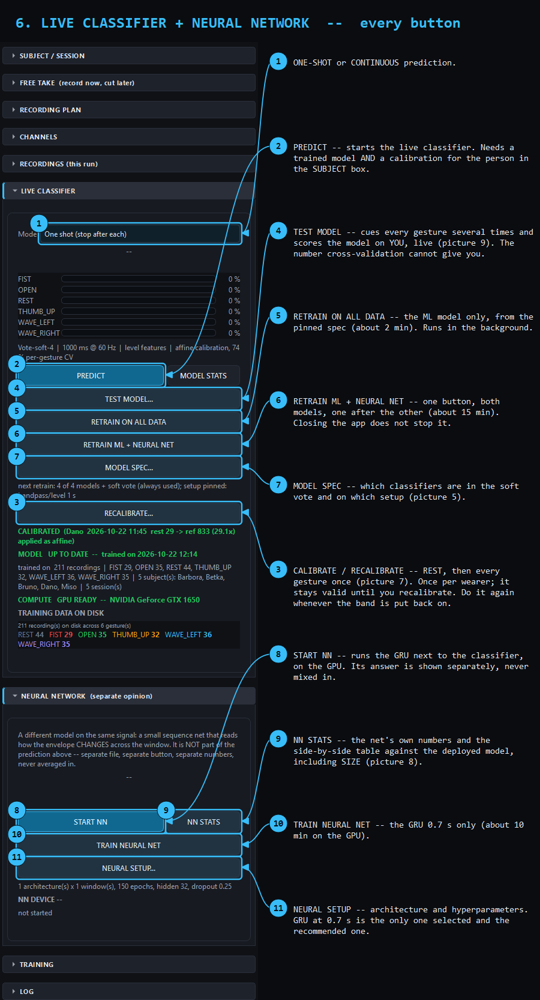
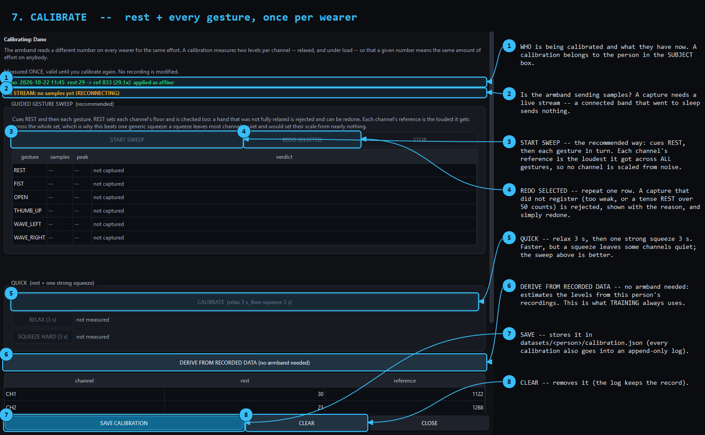
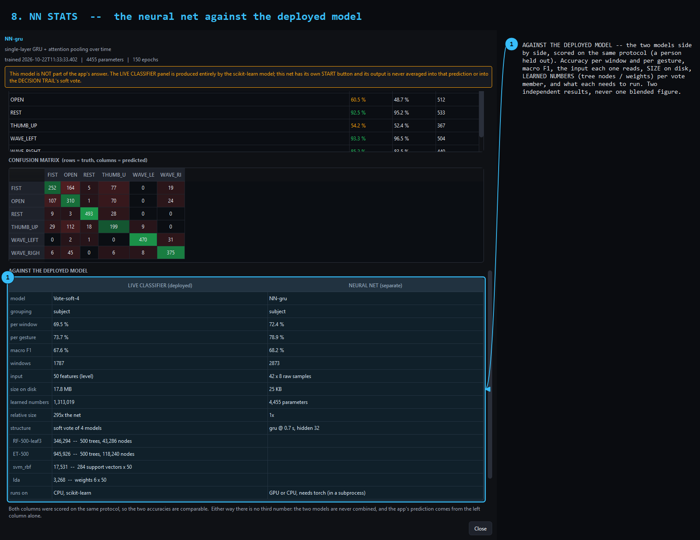
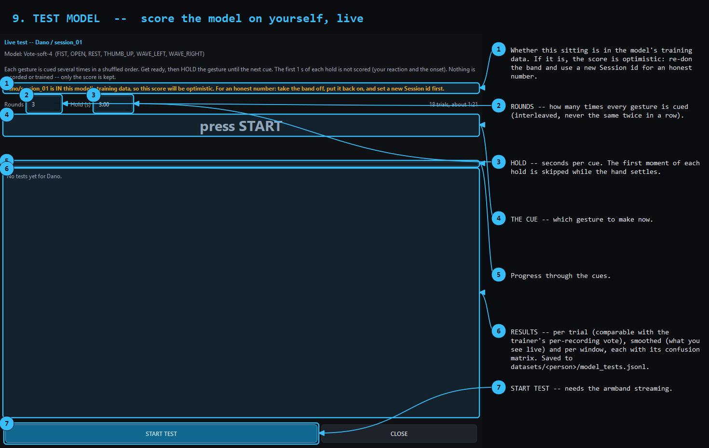

# UI guide — what every control does

A visual walkthrough of the recorder. Every arrow in these pictures was placed
from the widget's real geometry by `tools/make_ui_guide.py`, not drawn by
hand, so an arrow either lands on the live control or the generator fails.

The screenshots show the project's real state: the real model, the real
decision panel, a real take off disk. Nothing in them is mocked up.

> New here? Read [the five-minute version](#the-five-minute-version) first,
> then come back for the detail.

---

## 1. The main window


The layout never changes: **graph on the left, controls on the right, banner
across the top, status bar along the bottom.**

The graph is the part to trust. It stays live through every other operation —
even the review step draws a finished take over these same eight curves
without pausing capture, because samples are collected on the acquisition
thread and a slow frame must never cost you data.

**The banner is the thing to watch during a session.** It is deliberately
oversized: during a recording you are looking at your hand, not at a 10 px
label. It tells you what to do right now (`REST` → `GET READY` → `RECORD NOW`)
and turns orange the moment the link drops.

### Bottom bar

| Control | What it does |
|---|---|
| **START SESSION** | runs the cued plan: for every gesture × repetition, `REST → GET READY → 3-2-1 → RECORD` |
| **RECORD (manual)** | one take right now, outside the plan |
| **SAVE GRAPH** | current view as PNG or SVG into the session's `_graphs/` |
| **EXPORT DATASET** | combined ML bundle (`.npz` + index CSV + summary) into `exports/` |

### Status bar

Connection, sample rate, buffer fill, counts, and the **GPU/CPU chip**. That
chip is answered by a subprocess probe and never by importing torch into the
recorder — the import costs ~7 s and attaches a GPU context to a process that
must not drop samples. Until it answers it reads `checking…`, never a guess.

---

## 2a. The control panel — top half


Each section folds away by clicking its header. On a laptop screen they do not
all fit at once, and scrolling past the one you want is the single most common
irritation in this UI — so fold the ones you are not using.

**SUBJECT / SESSION.** Use a **new person id for every new subject.** Data is
stored per person, and that is the whole mechanism behind
leave-one-person-out validation. Edits here are mirrored back into the module
globals, so the metadata written to disk always matches what actually
happened.

**LABEL ON GRAPH.** Select a span on the live plot and save it as a labelled
clip — no countdown, no plan. `SELECT LAST n s` sets the span, `ADD SELECTION`
writes it, `UNDO LAST` takes it back.

**FREE TAKE.** Record now, cut later. One continuous capture, minutes long,
which you carve clips out of whenever you like.

> **A take is never training data, and two independent mechanisms enforce
> that.** It lives in `_takes/`, which `discover_recordings()` prunes, and it
> carries stage `take`, which no stage selector asks for. Loading five minutes
> of mostly-rest signal as one labelled gesture would quietly wreck a model,
> so `tests/test_free_take.py` checks both.

**MARKERS & NOTES.** `Ctrl+M` for a note, `Ctrl+B` for a break. The timestamp
comes from the newest **sample**, not the GUI clock, so markers line up with
the signal. The log is append-only: a correction is another marker, never an
edit.

**RECORDING PLAN.** Gestures × repetitions for the cued sequence. Leave the
order **interleaved** — it spreads fatigue and electrode drift across every
label instead of baking it all into whichever gesture you recorded last.

---

## 2b. The control panel — bottom half


**CHANNELS** hides pods from the display only. All eight are always recorded.

**RECORDINGS (this run)** is what this sitting produced, with quality and trim
state per row. `DELETE LAST` moves files to `_deleted/` — it never calls
`os.remove`.

> ⚠️ **Do not press AUTO-TRIM ALL on clips cut from a take.** `detect_activity`
> keeps the *strongest* region by design, and in the relaxed-hold recording
> protocol the hold is the **weakest** part of the clip. Measured on 17 real
> relaxed-hold clips: it kept a median of 70.8 %, worst case 42.4 %, and in
> **16 of 17** the discarded part was weaker than the kept part — at
> amplitudes of 50–90, precisely the band the protocol exists to capture. It
> is also unnecessary: a clip cut from a take has the whole clip as its label
> window, so **your selection already is the trim.**

**LIVE CLASSIFIER.** The deployed ML model — the app's answer. One-shot or
continuous, drawn over the graph with per-class probability bars. Every
button is in [picture 6](#6-live-classifier-and-neural-network--every-button).
The provenance line reads one of four states and never guesses:

| State | Means |
|---|---|
| `NO MODEL TRAINED` | no payload on disk |
| `TRAINED on <date>` | a model, but it cannot say what it was trained on |
| `UP TO DATE` | its dataset fingerprint matches the disk exactly |
| `OUT OF DATE` | the dataset changed; the tooltip says how |

**NEURAL NETWORK.** The GRU: a separate second opinion with its own START,
bars and statistics, running in its own process on the GPU. It is never
averaged into the answer above.

**TRAINING.** Progress, ETA and the live log of whatever is training. The
trainers run as a **background job** (`training/train_job.py`), not a thread
and not a child of the window: closing the app does not stop them, and
reopening it reattaches. The ML trainer runs on the **CPU** even when the GPU
badge is green — scikit-learn has no GPU backend, and the dialog says so.

---

## 3. MODEL STATS


Opened from the LIVE CLASSIFIER panel. **It is not modal**, on purpose: the
trail follows the live classifier, and a modal dialog would mean you could
only watch it if `PREDICT` happened to already be running.

**DECISION TRAIL** — one window, every candidate's vote, and how they fuse.

- **LIVE** runs the stored members on the window you just made. It is a
  *demonstration*, not an honest score — those members were fitted on the
  whole dataset — and the caption says so every time.
- **RECORDED** replays out-of-fold probabilities captured during training,
  where each window's recording was held out of the fold that scored it. This
  is the honest half.

**FEATURE SPACE** — every training window as one point, with the live window
drawn on the same axes.

It is a **PCA, not an LDA**, and that matters. An LDA picks axes that separate
the labels, so an LDA scatter looks beautifully separated even when the
separation comes from electrode drift rather than from the gesture — it would
flatter the model by construction. PCA never sees the labels, so what you see
is the structure really in the features.

Three colourings, because each asks a different question:

| Colour by | Question |
|---|---|
| **gesture** | do the labels form their own clusters? |
| **take** | …or do the clusters follow the recording session? **If this looks tidier than "gesture", the model is reading the block, not the gesture.** |
| **amplitude level** | where the effort sits, and the gap a relaxed hold falls into |

The **take** colouring is the single most useful diagnostic in this
application. Use it.

---

## 4. OPEN TAKE(S) & CUT CLIPS


Carving labelled training clips out of a free take, any time after recording.

Drag the green band or type the bounds. `NEXT >>` (`Ctrl+Right`) steps one
clip length along, so you can walk a take end to end.

**Where to put the span:** start just after the signal has clearly risen, end
before the release. Keep it on the settled, **relaxed** part of the hold.
Exclude flat rest at either edge — a pure-rest window labelled as a gesture is
how you get false positives firing while your hand sits still.

**How long:** about 2.5–3 s. The deployed ML model reads 1.0 s windows at
0.75 overlap and the net 0.7 s, so a 3 s clip gives each about 9–13 training
windows. Going longer does not buy more data
— windows are deduplicated against the source timeline anyway — it just drags
in ramp.

Each `EXTRACT CLIP` (`Ctrl+Space`) writes an ordinary stage-`raw` recording
with its **own** uid and full provenance (`parent_take_uid`,
`take_start_index`, `capture_style: cut_from_take`). Its own uid matters:
twenty clips sharing the take's uid would look like twenty versions of one
recording. The take itself stays byte-identical.

---

## 5. MODEL SPEC


`Ctrl+Shift+M`. **Which classifiers the sweep trains is data, not code.** It
is written to `models/model_spec.json`, and the GUI passes `--spec` on every
retrain, so what the subprocess trains is always what this dialog was showing.

You can have several candidates of the same kind with different
hyperparameters — SVM at C=1, C=10 and C=100 are three rows, each scored
separately by the same cross-validation.

**Voting.** The ensemble is added as one more *candidate*, not as a
replacement, so it is scored against its own members. `soft` averages the
member probabilities; `hard` counts the votes. "Always save" forces it to be
kept even if a single model scored higher — a choice, not an improvement.

**AUTO mode expands, it does not search.** Each enabled model becomes up to
`max_per_model` concrete candidates which go through the *existing* evaluation
path. There is no second scoring route to keep honest, every combination gets
its own row, and the sampling is seeded so a sweep is reproducible. The
configured values are always combination #1.

> The cost is **selection bias**: choosing the best of N candidates on the same
> folds makes the winner's score optimistic. That is stated in this dialog, in
> the training log and in MODEL STATS rather than hidden — safety rule 11,
> "selecting a model never flatters it".

A hand-edited `model_spec.json` cannot crash a sweep an hour in.
`validate_model_spec()` never raises and never returns something the trainer
cannot build: an unknown kind is dropped, a bad value coerced, an
out-of-range value clamped, a duplicate name renamed, and a spec with
everything disabled gets one model switched back on. Every correction is
reported as a string the GUI shows and the trainer logs.

## 6. LIVE CLASSIFIER and NEURAL NETWORK — every button



The two panels hold the two models, in reading order: **the app's answer
first, then the separate second opinion.**

| Button | What it does |
|---|---|
| **Mode** | one-shot (one answer, then stop) or continuous |
| **PREDICT** | starts the deployed ML model on the live stream. Needs a trained model **and** a calibration for the person in the SUBJECT box — without one it refuses rather than answer on the wrong scale |
| **MODEL STATS** | the cross-validated numbers, the DECISION TRAIL and FEATURE SPACE (picture 3) |
| **TEST MODEL…** | scores the model on *you*, live (picture 9) |
| **RETRAIN ON ALL DATA** | retrains the ML model from MODEL SPEC (~1.5 min, CPU) |
| **RETRAIN ML + NEURAL NET** | both models, one after the other (~12–14 min) |
| **MODEL SPEC…** | which classifiers are in the vote, on which setup (picture 5) |
| **CALIBRATE / RECALIBRATE…** | this wearer's rest and reference levels (picture 7) |
| **START NN** | runs the GRU next to the classifier, in its own process on the GPU |
| **NN STATS** | the net's own numbers, and the table against the deployed model — accuracy *and size* (picture 8) |
| **TRAIN NEURAL NET** | trains the GRU 0.7 s (~10–12 min, GPU) |
| **NEURAL SETUP…** | architecture and hyperparameters; GRU 0.7 s is the only one selected and the recommended one |

**Training runs in the background.** RETRAIN, TRAIN NEURAL NET and RETRAIN
ML + NEURAL NET start a detached job. Close the app and the job keeps going;
open it again and the TRAINING panel reattaches and reports the result. On
close the app asks whether to keep training or stop it. While a job runs, the
button that started it becomes its CANCEL.

**The two models are never combined.** The net has its own bars and its own
statistics. Where the two disagree, the NEURAL NETWORK panel says so —
"the classifier says OPEN 71 %, the net says WAVE_RIGHT 64 %" — and the
app's answer is still the classifier's. How the two compare in accuracy,
speed and size: [`MODELS_COMPARED.md`](MODELS_COMPARED.md).

---

## 7. CALIBRATE



A calibration is two levels per channel — relaxed and under load — measured
once per wearer, so that a number means the same effort on anybody. The
models were trained on calibrated signal, so **every wearer must calibrate
before PREDICT or START NN will run for them.**

1. **START SWEEP** (recommended): it cues **REST**, then **each gesture** in
   turn. Hold each one firmly until the next cue. Every channel's reference is
   the loudest it got across all gestures, so no channel ends up scaled from
   noise.
2. A row that did not register is **rejected with the reason** — too weak,
   or a REST that was not relaxed (any channel over 50 counts). Select it and
   press **REDO SELECTED**.
3. **SAVE CALIBRATION**. It is stored in
   `datasets/<person>/calibration.json`, and every calibration also goes into
   an append-only log next to it.

**QUICK** (relax 3 s, then one hard squeeze) is the fast alternative. **DERIVE
FROM RECORDED DATA** needs no armband: it estimates the levels from the
person's recordings, which is exactly what the trainers use for training.

**When to recalibrate:** every time the band is put back on. A calibration
describes where the pods sit, and that changes with every fitting.

---

## 8. NN STATS — the neural net against the deployed model



The bottom table, **AGAINST THE DEPLOYED MODEL**, is the only place the two
models appear side by side. Both are scored on the same protocol (a person
held out), and the table says so — or warns when they were not.

| Row | What it shows |
|---|---|
| per window / per gesture / macro F1 | the cross-validated accuracy of each |
| input | 50 features from a 1.0 s window, against 42 × 8 raw samples (0.7 s) |
| size on disk | the files, measured: ~18 MB against 25 KB |
| learned numbers | what each model stores to predict — tree nodes, support vectors, weights — with **one row per member of the soft vote** |
| relative size | the ML vote is ~300× the net |
| runs on | scikit-learn on the CPU, against torch in a subprocess |

Above the table: the net's per-gesture accuracy, its confusion matrix (rows
are what was made, columns what it said), and its inference worker's state
and measured latency.

---

## 9. TEST MODEL — the number cross-validation does not give you



Cross-validation answers "how good is this on a stranger". TEST MODEL answers
"how good is this **on me, now**":

1. Calibrate first, with the band on as you will use it.
2. Choose **Rounds** (how many times each gesture is cued) and **Hold**
   (seconds per cue).
3. **START TEST**, then make each gesture the big cue shows and hold it until
   the next one. The first moment of each hold is not scored, while your hand
   settles.
4. **Results** gives three numbers, each with its confusion matrix:
   - **per trial:** the majority of a hold's windows; comparable with the
     trainer's per-recording vote;
   - **smoothed:** what the panel shows you live;
   - **per window:** the raw score.

The orange line at the top says whether this person and session are in the
model's training data. If they are, the score is optimistic: take the band
off, put it back on, set a new Session id and calibrate again for an honest
number. Every result is saved to `datasets/<person>/model_tests.jsonl`.

---

## Keyboard shortcuts

| Key | Action |
|---|---|
| `Ctrl+Shift+R` | START / STOP free take |
| `Ctrl+Space` | EXTRACT CLIP (cut dialog) · ADD SELECTION (live graph) |
| `Ctrl+Right` / `Ctrl+Left` | step one clip length forward / back |
| `Ctrl+M` | add a note marker |
| `Ctrl+B` | add a break marker |
| `Ctrl+Shift+Space` | CUT SINCE LAST MARKER |
| `Ctrl+Shift+M` | MODEL SPEC editor |
| `Ctrl+Return` | ACCEPT & NEXT (review step) |
| `Ctrl+R` | REDO this repetition (review step) |

The review shortcuts use a modifier deliberately. A bare `Space` or `R` window
shortcut would swallow those characters while you are typing in the Notes
field.

---

## The five-minute version

**A new person, from nothing to live predictions:**

1. Put the armband on. Wait for the link pill to go green.
2. Set **Person id** and **Session id**. A new subject gets a new id.
3. **CALIBRATE** → START SWEEP → SAVE CALIBRATION (picture 7).
4. **Record:** `START FREE TAKE` (`Ctrl+Shift+R`). Per repetition: rest ~3 s →
   make the gesture → let it settle → **hold it relaxed for ~4 s at the effort
   you would really use** → release. Interleave the gestures; do ~6 of each.
   Then `STOP & SAVE TAKE`.
5. `OPEN TAKE(S) & CUT CLIPS` → cut ~3 s clips from the settled part of each
   hold. **Do not press AUTO-TRIM ALL.**
6. **RETRAIN ML + NEURAL NET** (~12–14 min). You may close the app; it keeps
   training.
7. **Restart the app.** Put the band back on and **CALIBRATE again** — the
   band now sits differently.
8. **PREDICT** (the ML answer) and/or **START NN** (the second opinion).
   **TEST MODEL** tells you how well it works on you.
9. **Take the armband off and walk away.** Record another sitting on another
   day.

Step 9 is not optional padding — it is the entire point. A gesture recorded
on only one electrode fitting cannot be told apart from that fitting, no
matter how good the model is. See [`EDA.md`](EDA.md) and
[`../CLAUDE.md`](../CLAUDE.md) §8f.

---

## Regenerating these pictures

```powershell
python tools/make_ui_guide.py . docs/images
```

It builds the real window with `MYO_PORT` pointed at a port that cannot exist,
so no hardware is touched, and renders with `WA_DontShowOnScreen` so nothing
appears on your display. It uses the **native** platform plugin rather than
`offscreen`, because the offscreen plugin ships no font database and renders
every glyph as a tofu box.
